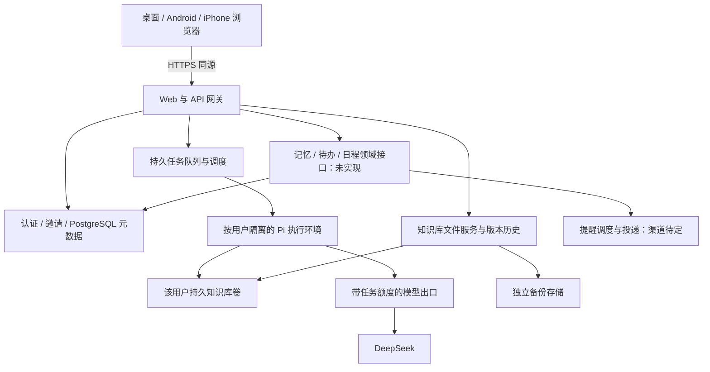

# Corilo 可里技术设计

v0.15 · 2026-10-21。用户已决定转为云端个人助手、邀请制小范围使用。以下区分目标架构与阶段实现；现已增加云端邀请/文件服务开发入口，未部署，真实身份联调与隔离 Agent 未完成。

## 1. 架构



正文保持普通 Markdown 与附件，工作树落在 Linux 持久磁盘；PostgreSQL 保存控制元数据及后续记忆关系、待办、日程和提醒的结构化记录，不把正文同时存进数据库制造双写。Pi 与文件服务操作同一用户目录。浏览器没有本地 Node、Git 或 Termux 依赖。

首期一台 Linux 主机承载网关、文件服务和执行调度，数据库可托管，备份离开该主机。此为小规模部署拓扑，不是高可用承诺；主机丢失时按备份恢复。无需首期引入 Kubernetes、Redis 或微服务集群。

## 2. 技术选择与实现边界

| 部分 | 选择与边界 |
|---|---|
| 页面 | 保留完整 Files.md 与现有适配层，响应式网页，同源 API；PWA 后补 |
| 服务 | Node.js 24 与现有 Pi SDK 锁版本，Linux 长运行服务 |
| 账号 | 已选用 Supabase Auth 适配器，真实项目尚未联调；应用自己核验邀请与成员状态，不信任客户端 userId |
| 元数据 | PostgreSQL；可与 Supabase 同用，用于身份映射、库归属、任务、事件和额度 |
| 正文 | 每用户持久 POSIX 目录；不将 Supabase Storage/R2 直接当 Pi 工作目录 |
| 版本与备份 | 每库 Git 历史，加独立对象存储备份；R2/S3 兼容存储可选 |
| 执行 | 按用户隔离的 Linux worker，默认 Pi 工具；限制资源和网络出口 |
| 模型 | 首期 DeepSeek；沿用 Pi provider/settings，平台凭据保留在模型出口服务 |
| 域名 | 已有域名，可继续 Cloudflare DNS；HTTPS 网关提供同源页面与 API |

代码已选择 Supabase Auth 的适配方式，当前环境未配置真实项目，本次未开通资源或产生服务费用。身份提供商可替换，已验证主体到内部账号的映射保持稳定。Pages 可后续分发静态页面；Workers、普通 Vercel 函数不承载默认 Pi shell 和持久工作树。首期同源服务避免不必要的跨域认证配置。

## 3. 控制面与数据布局

网关验证登录会话、账号有效性、资源归属和 CSRF/Origin；使用 HttpOnly、Secure、SameSite 会话 cookie，不沿用本机 URL fragment token 做云端账户。当前实现采用服务端验证邮箱/密码，没有 OAuth 回调。未来若增加 OAuth/授权码登录，其回调必须核验 state/PKCE；密钥不进入网页或知识库。浏览器不使用数据库 service-role key。

邀请兑换和建库需要数据库事务及唯一约束。当前 schema 包含 accounts、invitations、vaults、sessions，以及新增的 conversations、runs、run_events；usage 仍未实现。任务表与内部持久任务服务已加入迁移，但网关尚不开放任务 API，未连接实际 worker。个人待办另用 todos 概念，与 runs 分开；记忆、日程、提醒的目标结构见第 13–15 节，尚无对应迁移。邀请只存不可直接复用的摘要、接收身份、期限及兑换记录。userId 从已验证会话解析；vaultId/conversationId/runId 查询均带所有者条件。

服务端布局示意（与当前 gateway 目录参数对齐；cloud-files 不启动 Pi，sessions 为后续预留）：

```text
持久卷 /tenant/<内部库ID>/
  knowledge/       Markdown、附件、内部 .git
  state/sessions/  Pi 原生会话
  pi/              该用户 Pi 原生设置；不含平台长期密钥
控制数据库          账号、邀请、任务状态、事件及额度
独立备份存储        带版本清单的正文/历史/必要状态快照
```

API 不向用户暴露宿主绝对路径。文件、搜索、下载和导出共用归属检查与路径边界检查。客户端目录名不能直接用作宿主租户路径。用户可影响的链接不跟随到卷外；下载内容不能变为同源可执行 HTML。

## 4. Pi 执行与隔离

Pi 默认工具、设置和会话继续使用，不重写 Agent 框架。每库最多一个执行租约，worker 只挂载该用户需要的知识库和状态目录；空闲回收 worker，不永久给所有注册用户开进程。文件服务可在没有活跃 worker 时读写知识库。

worker 使用非 root、受限 CPU/内存/PID/磁盘、最小能力和受控挂载，不开放 Docker socket，不提供控制数据库或对象存储管理凭据。禁止访问其他租户、宿主内部网络、实例元数据和管理端口。仅 cwd、不同 UID 或系统提示词不能代替完整隔离。容器共享内核仍有风险：邀请制测试先验证限制；公开运行不可信代码前评估 gVisor/微虚拟机等更强边界，不宣称普通容器绝对安全。

不能给可执行 bash 的 worker 注入平台 DeepSeek 长期密钥。使用 Pi 原生支持的 provider endpoint 设置连接内部模型出口，提供短期、限任务、限模型、限额度的调用身份；出口持有真实密钥、计量并撤销任务身份。worker 即使读取自己的调用身份，也不能越过该任务预算或读取其他用户资源。出口兼容性须对固定 Pi 版本做真实模型验证。这是平台凭据与用量边界，不新增用户模型配置表单。

首期不开放任意终端、扩展安装或插件市场；保留默认工具行为。网络请求走受限出口，必要模型调用和执行控制与一般互联网访问分开管理，防止内部网络探测。

## 5. Agent 执行任务与保存协调

PostgreSQL 兼任首期队列，不先引入 Redis。提交 prompt 以用户/会话作用域的 idempotency key 建唯一记录；持久化成功后返回任务 ID。调度器以事务取任务、获得每库租约并记录 worker 身份、心跳和过期时间。UI 可轮询持久事件，后续切 SSE；连接只是观察者，不掌控执行生命周期。

资源上限先配置后放行：每用户一个修改任务，全局并发与排队上限、最大执行时长、模型用量和存储额度。额度检查必须在服务端，实际消耗在模型出口记录；API 重试不能绕过计量。超时或停止需要终止任务的整个执行环境及其子进程，等待确认后才释放文件写入占用。

租约过期不等于进程已经死亡。失联后先隔离/终止旧 worker，避免新旧执行同时改同一库；确认结果前保持受限状态。持久任务标记 interrupted，不自动重放 shell。任务开始/结束、停止原因及必要进度写入控制状态，Pi 原生会话保存在独立目录。文件修改与任务状态不具备跨系统原子性，崩溃恢复需核对文件和历史，不能仅相信“完成”字段。

沿用现有文件 SHA/ETag 保护，在服务端扩大到全部设备和变更接口。新建、写入、移动、删除、恢复与 Agent 开始受每库协调控制；上传和请求体有大小限制。文件创建、移动、删除均增加库 revision，重连按 revision 刷新。其他设备的未保存草稿仍可能陈旧，保存时拒绝旧版本，不把通知机制当并发锁。

## 6. 历史、备份与迁移

Git 继续提供每库历史和 Agent 前后保存点，配置与秘密不入库。Git 默认工具可能修改挂载卷内容，历史不是防恶意篡改边界；独立备份由 worker 无权访问的服务完成。备份在协调的一致性窗口或存储快照上取得，记录文件/状态清单和摘要；恢复要实际重建并比对，分别定义正文、会话及任务记录的恢复目标。

迁移采用用户主动导入文件或安全归档，不删除原本地库，不自动带入 `.git`、Pi 配置或旧认证。先在暂存区校验路径、总量和名称，再发布并建立新的云端历史。用户导出普通 Markdown 与附件，云端无锁定格式。

现有 GitHub 双向同步实现保留回归测试，但云端首期不加载对应 UI、不自动调用旧 sync API。后续集成需独立设计服务端凭据与备份语义，不能直接复用开发机 credential helper 作为多用户认证。

## 7. 对现有代码的处理

| 现有实现 | 云端改造 |
|---|---|
| `app/vendor/filesmd/` | 保留原样、许可和固定来源；不重写编辑器 |
| `app/web/adapter.js` | 保留文件句柄适配，改为账户会话认证与云端错误处理 |
| `app/web/app.js` | 保留保存与对话，新增跨设备 revision、任务 ID、重连和草稿冲突语义 |
| `app/host/vault.mjs` | 复用普通文件/ETag/Git；补云端所有变更接口的版本与租约协调 |
| `app/host/agent.mjs` | 在隔离 worker 内复用 Pi SDK；配置与会话明确按用户分离 |
| `app/host/server.mjs` | 拆开认证/授权、文件服务与执行调度；不能简单改监听地址部署公网 |
| `app/host/sync.mjs`、`app/web/sync.js` | 暂保留旧模式和测试，退出云端首期入口 |
| `android/`、`app/host/android.mjs` | 暂停，保留历史；不再自动构建 APK 或要求 ARM64 bootstrap |
| `prototype/`、`p0/` | 历史资料，不扩展为云端入口 |

## 8. 实施顺序

| 阶段 | 可审查的完成条件 |
|---|---|
| 0 方向切换（已完成） | 正式设计、开发约束和 README 区分当前与目标；Android CI 仅手动保留 |
| 1 邀请与文件基础（部分实现） | 真实身份联调、独立建库、两账号访问隔离；跨设备保存/删除/移动冲突保护与重启恢复 |
| 2 服务端 Agent（持久任务基础已实现） | 受限 worker、持久 run 和幂等、停止/中断、模型出口额度；真实 DeepSeek 文件链路 |
| 3 个人记忆与行动（设计细化，未实现） | 来源与纠正、todos/events/reminders 分离；确定渠道后实现一次性提醒、修改取消和送达失败反馈，对应 N17/N18 |
| 4 资料自主与完整体验（部分基础） | 对话与事项引用的完整账号导出/导入恢复、历史恢复、独立备份；移动端对话与事项操作，对应 N13/N14/N16/N19 |
| 5 邀请版验收与上线（未完成） | 按 N01–N19 核对目标个人助手；明确待定产品策略、部署与运营参数，不能以文件开发版替代 |

阶段 1 可先联调文件服务；隔离/额度未完成前不向受邀用户开放 Agent。真实部署、开通云资源及付费另按用户授权执行。先做单机可用架构，数据卷与 worker 的位置关系明确后再讨论多机扩容；不能让任意机器读取仅存在另一台机器的本地目录。

## 9. 方向切换时的证据与限制

历史快照（方向切换提交 4bdf59b）：当时只完成方向、实施边界和 CI 触发调整，没有实现云端登录、租户隔离、数据库、远端任务或部署。现有本机宿主保持 loopback 约束，不开放公网端口。

此前 19 项 Node 检查与三套 Chromium 检查覆盖本地编辑、Pi 协议替身、Git 同步；它们不证明云端多用户能力。无真实 DeepSeek 和 iPhone/Android 浏览器验收。Android Actions 流程曾推送，但远端运行结果未确认；当前分支取消自动触发不会取消其他分支已排队或正在运行的任务。

旧版本完整设计、来源调查与检查记录保存在 [v0.12 提交](https://github.com/keanrain/corilo/tree/e25edb9/docs)。Files.md 来源以 `app/vendor/filesmd/SOURCE.json` 为准，Pi 以 `package-lock.json` 为准；商业发布前按实际依赖核对许可，不能用旧调查结论替代审查。

## 10. 个人助手方向与首批资料导出（2026-10-21）

最新定位为个人记忆与行动助手，简单使用和资料自主是产品约束。正文仍是普通文件；未来记忆关系、任务、提醒、时区及执行状态放入结构化存储，用引用关联资料，避免同一截止日期在 Markdown 与数据库双向维护。Pi 负责理解与推理，调度器负责确定时间的执行。一次性提醒先于外部日历、周期计划和主动回顾；公开接口与验收按业务规格第 6 节，不恢复旧原型业务。

历史快照（导出提交 5039344）：新增 `app/host/export.mjs` 和鉴权后的 `GET /api/export/knowledge`，在当前宿主管理的写入队列内创建 ZIP。采用锁定版本 fflate，保存普通文件原字节和相对路径、空目录、清单与格式说明，拒绝链接/特殊文件并限制总量，前后核对已读文件状态。页面“导出知识库”先保存草稿再触发浏览器下载。当时只接入本机接口；后续 9a22e27 已经通过云端网关复用。两种模式的 ZIP 都不是完整账号备份。

该提交先落地知识库导出；随后邀请登录和云端文件链路的实际进展见第 11 节。之后是隔离 Pi、可追溯记忆与任务、可靠的一次性提醒。不得把尚未落地的记忆/任务/日程写成当前已有功能。

本轮实测：21 项 Node 测试与三套 Chromium 脚本通过，新增真实页面下载 ZIP，并用 Python 标准库解压比对最新草稿。覆盖导出授权、附件字节、中文路径、空目录、校验清单、链接拒绝、资源上限与 Agent 互斥。无模型调用，不代表云端或移动端验收。

## 11. 邀请与云端文件首条链路（2026-10-21）

`app/cloud/accounts.mjs` 使用 PostgreSQL 事务、账号级 advisory lock 和邀请行锁兑换准入；每账号唯一库。邀请绑定已验证邮箱，仅存摘要，支持过期/撤销检查；登录 cookie 仅存随机会话凭证，数据库保留摘要和期限，查询时检查账号停用状态。Supabase password grant 只作为服务端身份验证，校验已确认邮箱与身份，不把 provider token 交给页面或写进知识库。当前使用已开通并验证的 Supabase 账号，无自助注册、OAuth 回调或邮件投递；不存在未实现回调却声称 PKCE 已通过的问题。

`gateway.mjs` 检查公共 origin、写请求来源和会话，并按数据库里的 vault UUID 选择文件宿主；不接受请求提供的用户目录。入口 loopback，生产需同机 HTTPS 代理。内部宿主使用 cloud-files 模式，禁止 Agent/Git 同步 API，不实例化 Pi 和 GitSync；页面隐藏 GitHub 入口、禁用 AI 发送，保留原话保存、编辑与 ZIP 导出。状态不返回磁盘绝对目录，新增文件也推进 revision，无草稿页面可刷新其他设备修改，旧版本写入仍被 ETag 拒绝。

真实 PostgreSQL 17.6、磁盘和 Chromium 已验证：并发邀请兑换仅建一库、错误/过期/撤销邀请拒绝、跨账号读取和路径穿越拒绝、两个会话旧版写入冲突、退出/停用生效、正常重启后的会话与文件恢复；390px 浏览器完成登录、原话保存、ZIP 下载和退出，另一个独立浏览器会话自动看到新增笔记。文件 revision 仅在实际刷新后确认，保存/导航期间延后的刷新不会被丢弃。身份提供商使用合成适配器，Supabase adapter 独立用响应替身测试，未连接真实 Supabase 或 DeepSeek。这是文件/API 归属隔离，不是 Agent 执行沙箱。原有本机测试与三套浏览器回归继续保留。

单实例最多 20 个驻留文件宿主，满额报错；无空闲回收或多机路由。迁移、受邀账号预开通及登录密码恢复需操作方管理；独立备份、公网安全审查与真实身份联调仍需完成；本轮文件版本和 Linux 文件宿主锁恢复补强见下。新服务尚未部署。配置与检查命令见 `app/cloud/README.md`，不能将第一条链路宣称为邀请版已可上线。

### 文件并发与宿主锁补强（2026-10-21）

删除/移动 API 现在强制 expected 来源版本，在同一宿主变更队列内验证后执行，目标已存在仍拒绝覆盖。文件使用内容 SHA-256；目录使用排序后的后代路径与 inode/size/mtime/ctime 等元数据摘要，包含隐藏后代但不跟随链接，覆盖受管理的写入、新增、删除和移动。列表与读取加入宿主队列，前端从已展示列表/正文保留版本；打开编辑器的版本独立于后续 stat 查询，不能为了删除而自动换成最新版本。目录有变化时保守拒绝并要求刷新，不承诺约束任意外部进程的同时修改；大库目录扫描性能尚待测量。

Linux 宿主通过短暂 `flock` 子进程对继承的文件描述符加内核锁，由父进程保留该描述符，无常驻锁辅助进程。锁文件 inode 保留，退出只清除 PID 标记并释放描述符。只对明确的 cloud-files 标记、确认 PID 不存在的情况自动回收；活跃/权限不明/损坏/旧版和本机 Pi 标记均拒绝。用途限同机本地文件系统与同一 PID 命名空间，不适用于 NFS、多容器独立 PID 空间或多机租约。非 Linux 本机模式保留原有独占标记行为。云端 Pi 仍关闭，不把文件宿主恢复推广为 Agent 子进程或 Git 写入中途的恢复保证。

验证增加真实 HTTP 旧版本删除/移动、目录后代变更、竞争移动、SIGKILL 后重启与并发启动单占用、未知标记拒绝；Chromium 验证过期页面删除/移动拒绝、刷新后目录操作成功；两个登录会话验证旧文件版本不能删除或移动新内容。Node 与浏览器回归、真实 PostgreSQL 云端检查结果记录在本轮提交；Supabase 仍为测试替身，无真实模型或移动真机验收。

### 持久任务基础（2026-10-21）

`app/cloud/runs.mjs` 新增内部 Runs 服务；`--migrate` 建立 conversations、runs、run_events，数据库复合外键校验账号/知识库/会话归属。创建会话及提交只接受控制面已验证的 owner；同一账号/会话/请求键返回原 run，不同正文复用键报冲突，数据库部分唯一索引保证每库最多一个 queued/running/stopping 任务。请求正文保存在私有任务表，不能复制到普通日志；其保留与账号删除策略仍需在开放前落实。

控制面必须显式提供最大执行数、排队数、租约秒数及任务时长，所有控制面实例须使用同一部署配置。短事务 advisory lock 串行容量检查、领取及状态变更；状态事件同事务提交。领取返回限任务随机身份，只存摘要；查询视图不暴露执行身份和 prompt。事件按游标读取，每次最多 100 条；这不是完整 Pi 消息/工具事件存储。

排队停止直接进入 stopped；执行中停止进入 stopping，并保留知识库及全局名额。过期租约不能续期，仍占名额，不自动重排。恢复先把异常任务设为 stopping，使旧执行不能继续续期；事务外由可信控制器停止并确认整个 worker 不再存在，成功后再写 interrupted 或 stopped 并释放名额。停止失败或无法确认则维持占用。账号停用阻止读写任务，排队任务中断，执行任务等待确认终止。整个服务尚未接收浏览器/worker 直接请求；`finish` 和恢复回调只能由可信控制器在确认退出后调用，不能用模型文字或 worker 自报成功替代。

真实 PostgreSQL 测试覆盖双提交、错用幂等键、跨用户读/停止拒绝、容量竞争、停止与完成竞争、过期续期拒绝、停止失败保留占用、服务/连接池重建后读取记录、超时与账号停用、不自动重放，以及数据库跨账号外键拒绝。停止确认回调为测试替身，没有执行真实 worker；不算 N10/N11 隔离执行验收。

尚缺执行控制器及其“启动/终止”互斥、文件宿主写入协调、容器隔离与资源额度、模型出口及 AI 用量预算、Pi 会话关联、完整消息事件和前端重连。现有网关继续返回 Agent 503；没有增加开发绕过开关，不能调用内部 `claim` 就宣称已可运行云端 Pi。下一条纵向链路须连接上述边界并实测实际进程停止。

## 12. 四项设计的共同边界

以下是 v0.15 实现方案，不是已可运行功能；第 11 节仍是当前代码证据。业务行为与待定策略统一见 [业务规格第 6–8 节](PRODUCT-SPEC.md#6-简单使用与资料自主)。沿用一个 Node 网关、PostgreSQL、每用户文件目录与隔离 Pi，不新增 MCP 框架、向量服务、Redis 或工作流平台。

| 数据 | 权威来源 | 派生视图 |
|---|---|---|
| 笔记、附件 | 用户持久文件目录 | 搜索结果、导出文件 |
| 记忆、待办、日程、提醒 | PostgreSQL 领域记录 | UI 卡片、JSONL、ICS |
| 对话 | Pi 原生会话与持久 run 记录，按消息 ID 关联 | 跨设备页面、标准化导出 |

不自动把 Markdown checklist 与数据库待办双向同步。文件写入、数据库事务和外部通知没有跨系统原子性，分别记录成功与失败。结构化对象使用账号作用域内稳定逻辑 UUID，导入不接受包内账号身份；文件来源使用相对路径及版本/内容摘要，不为每个文件强制建立身份注册表。

实施依赖保持第 8 节顺序：先补文件基础与隔离 Pi，再实现领域桥接及明确记忆/待办，确定通知渠道后接调度，随后完成账号资料包和恢复。完整导出需随新增实体一起维护，不能等上线后才发现记录无法迁移。

## 13. Pi 与结构化数据桥接

路径为 `Pi 默认 bash → 普通 corilo CLI → 现有网关内领域 API → PostgreSQL`。不替换 Pi 默认工具，也不把数据库管理凭据交给 worker。浏览器调用相同领域服务的校验逻辑。CLI 只负责传输与格式，固定受控 PATH，业务 JSON 通过 stdin/文件传入，禁止拼接不可信正文为 shell 命令。

以下仅为接口草案，当前不可运行：

```text
corilo todo list --json
corilo todo create --key todo-1 --json-stdin
corilo todo update <id> --version 3 --key todo-2 --json-stdin
corilo operation get --key todo-1 --json
```

仅提供限域的读取、创建、修改、完成/归档等操作，不提供原始 SQL、任意 URL 转发或选择 tenant 参数。调度器签发短期调用身份，服务端存摘要并绑定 owner、vault、run、scopes、期限与预算；停止、账号停用或 run 结束即撤销后续调用。worker 可通过 bash 读到自身身份，所以安全边界是 API 归属检查、预算和网络出口，不是隐藏 CLI。身份过期后仍可通过用户正常会话查询已提交结果。

领域写入以 `(owner, run, operation_key)` 唯一；浏览器使用 `(owner, client_operation_scope, operation_key)`，不虚构 run。保存规范化请求摘要，重复键同内容返回原回执，不同内容返回 409。变更、回执与供 UI 查询的领域事件在同一数据库事务提交；更新、完成和取消带预期版本，冲突返回 409，不静默覆盖。回执包含 operationId、对象类型/ID/version、状态及变更字段；错误返回 code/message/retryable 并使 CLI 非零退出。

UI 成功卡读取已提交的领域事件/对象，不相信模型文字或可伪造的 shell 输出。幂等只保证同一键，不保证模型换键后语义上永不重复；run 中断不得自动重放历史有副作用命令。创建待办及其提醒可作为一个领域事务，但不能声称同时写文件或发送邮件也原子完成。

通知 API 只引用用户在可信 UI 中验证并启用的 notification_target；worker 不可指定任意收件地址、修改绑定或直接发信。出口禁止借平台通知凭据绕过 API，也禁止控制数据库、宿主内网和元数据访问。首期 worker 默认出口只放行模型出口与领域 API，拒绝任意互联网外发；后续网页检索或下载需要单独设计受限出口，不能因默认 bash 可用就允许任意 curl 绕过通知边界。第三方收件人与外部日历邀请不在首版接口中。验证映射 N09–N12、N18：跨账号、过期身份、换内容重试、并发旧版本、停止后请求、限额及出口绕过均须实际检查。

## 14. 记忆存储与检索

目标逻辑模型如下，尚未创建数据库表：

| 实体 | 最小字段 |
|---|---|
| memories | owner、logical_id、text、status(candidate/active/superseded)、evidence_kind(user_statement/document/inference)、source_refs、version、时间、可选 replacement_id |
| memory_suppressions | owner、来源标识/指纹、来源版本、时间；不存已遗忘正文 |

消息来源使用稳定 message ID；文件来源使用相对路径、内容摘要/版本和可选片段位置。source_refs 不复制整份原文；展示时检查来源是否仍存在及版本是否一致。用户明确纠正更新逻辑对象版本；若保留可见旧文本，须纳入导出与删除范围。冲突候选可引用现有对象，不能静默把相互矛盾的信息都加入 active 集合。

首批先实现明确“记住/纠正/忘掉”的闭环，候选提取默认策略按业务规格第 8 节决定。检索只在所属账号的 active 记录中进行，先用有界文本查询与中文子串匹配，限制条数与注入长度；候选不作为事实自动注入，不先引入知识图谱或向量数据库。

遗忘事务删除目标记忆、其派生索引并记录不含正文的来源抑制；缓存同步失效。自动提取检查同源同版本抑制规则，导入不触发重新提取。抑制不能阻止 Pi 默认文件工具读取仍保留的原文，也不能识别所有复制改写。完整删除需处理来源、可见历史、会话及备份保留，不能仅删一行就宣称语义遗忘。验证对应 N17/N19，包括并发纠正、失效来源、冲突、遗忘后重提取及导出恢复。

## 15. 事项与提醒调度

目标实体尚未实现：

| 实体 | 最小字段与约束 |
|---|---|
| todos | owner、logical_id、title、open/done/cancelled、可选 due_date 或 due_at/timezone、version、source_refs |
| events | owner、logical_id、title；定时 start/end/IANA timezone 或全天日期区间；version、source_refs |
| notification_targets | owner、渠道、受保护的目标绑定、验证及用户启用时间、绑定版本/状态；worker 只见不透明 ID |
| reminders | owner、logical_id、可选 todo/event 引用、fire_at、IANA timezone、输入本地时间、target_id/绑定版本、version、调度状态 |
| reminder_deliveries | reminder/version、attempt、稳定 provider request key、lease、投递状态、provider reference、时间与脱敏错误 |

所有外键和查询校验 owner。具体时刻存 UTC 并保留 IANA 时区和输入本地时间；全天日期不转换成午夜提醒。时区修改、夏令时歧义和待办完成规则遵循业务规格。通知绑定不放进知识库或 worker；渠道选择建议邮件，但未选供应商、未配置凭据。

提醒调度状态为 draft/scheduled/paused/cancelled/expired；每次投递另用 claimed/submitting/accepted/delivered/failed/unknown。调度器用 `FOR UPDATE SKIP LOCKED` 领取到期记录，领取带租约；发送前事务重新检查账号、对象版本、关联事项和目标绑定，持久化 submitting 后才调用渠道，不跨网络持有数据库事务。

submitting 是取消保证的分界：此前的取消/完成使发送检查失败，此后可能已提交，UI 明确无法保证撤回。修改形成新版本，旧投递不覆盖新版本状态。claimed 租约超时可重新领取；submitting 超时或进程死亡转 unknown，不简单退回 scheduled。只有确定未发送，或供应商幂等保障仍有效时自动重试；结果未知时查询供应商并调和，不能为了重试成功而重复通知。

供应商回调须验证真实性、去重并关联正确版本，不允许乱序回调把较新结果降级。accepted 只表示供应商接受，delivered 仅在有渠道证据时显示，均不代表用户已读。服务恢复按配置宽限决定补发或 expired，宽限与重试上限是上线前运营参数；导入一律 paused，不进入自动补发。

ICS 是 events 的派生视图，使用稳定 UID、SEQUENCE/DTSTAMP，正确转义、折行、时区与全天结束日期的排他语义，默认不带 VALARM；JSONL 才是恢复依据。验收 N18 覆盖 DST、发送前后取消竞争、重复回调、未知结果、停机过期及重新打开待办，不能只测试数据库去重。

## 16. 完整资料包、恢复与自托管

保留现有 `corilo-knowledge-export` v1 的范围；另设计 `corilo-account-export` v1，以下均未实现：

```text
manifest.json
README.md
knowledge/                         原始正文与附件
records/                           JSONL：memories、todos、events、reminders、
                                   conversations、messages、references、versions、forget-rules
history/blobs/<sha256>              仍保留且用户可见的历史内容
conversations/<logical-id>.md       可读会话视图
calendar.ics                       可读日历视图
```

manifest 含 format/version、exportId、UTC 创建时间、snapshotRevision、可迁移偏好、文件路径/大小/SHA-256、实体计数与排除项。日期采用明确的 UTC/IANA/全天类型；对象保留逻辑 ID 与引用。认证 subject、内部账号/库 UUID、密码摘要、cookie、调用身份、模型密钥、渠道凭据、容器状态、租约和内部调试日志不导出。会话导出标准化用户可见消息及结果，不直接复制含运行头和待执行工具状态的 Pi session；历史不导出原始 `.git` 隐藏对象。

一致性导出取得每账号写入协调门，等待 Agent 结束或用户停止得到确认；暂停新的提醒领取，将在途投递核定为已知结果或 unknown。取得数据库一致快照并复制文件/会话后释放门，在副本上压缩，不全局冻结服务。仅限制一库受管理写入，不宣称默认文件工具变成跨系统事务。

首版只向空目标恢复，步骤为上传暂存 → 校验/预览 → 获得库协调门 → 持久化 import 状态 → 发布文件与数据库记录 → 完成并释放门。归档校验包括路径越界、链接/特殊文件、解压大小/数量/比例、重复及 Unicode/大小写碰撞路径、格式版本、ID 与引用完整性。摘要用于完整性校验，不代表内容可信。导入 owner 来自会话，不来自包。

以 `(owner, exportId)` 和包摘要实现重试：同包返回既有导入状态，同 ID 不同摘要拒绝。文件暂存目录和 DB 发布不是一个原子事务；单主机采用持久 import 状态及可重入发布步骤，在文件与记录均就绪前阻止读取半成品，重启继续或安全清理未发布状态。现有 host 固定路径尚无这套发布机制，必须实现并逐阶段崩溃测试，不能直接依赖 rename 宣称原子恢复。

导入对象保留逻辑引用；历史 run 不恢复执行租约，旧对话只读，新请求建立新 run。提醒全部暂停，旧通知绑定不复用，未来提醒需用户重新绑定并启用。保留投递历史作为历史，不让它进入调度队列。源文件引用按路径/摘要检查，不要求强制文件 UUID 注册。

同服务恢复合并包外较新的删除/抑制记录，不复活停用账号；独立实例导入旧包按业务规格展示快照范围，不可能获知未知的后续删除。用户下载副本无法撤销；服务器临时包应有访问控制、短期下载有效期和清理。运营数据库灾备与用户资料恢复分开设计，不能用全库 SQL dump 冒充个人可迁移格式。

自托管最低交付是版本化镜像及 Compose 或同等部署配置、独立认证、PostgreSQL/持久卷、HTTPS、隔离 worker、通知配置、管理员初始化、备份恢复、升级/回退说明、资源要求和许可清单。当前 CLI 固定 SupabaseIdentity，需要可测试的自托管认证适配器，或完整说明自托管 Supabase 的额外资源，才能做到不依赖 Corilo 官方控制面；开源代码不等于已交付自托管。建议先完整包及空库恢复，再自托管，再用户指定备份，未承诺日期。

验收映射 N14/N16/N19：带中文、附件、来源/历史与遗忘规则的往返样例；跨账号与恶意归档；导出时并发写入；导入各阶段崩溃；恢复后零工具执行、零通知；未知投递保留；禁用 Corilo 官方域名仍能独立使用自托管实例。
