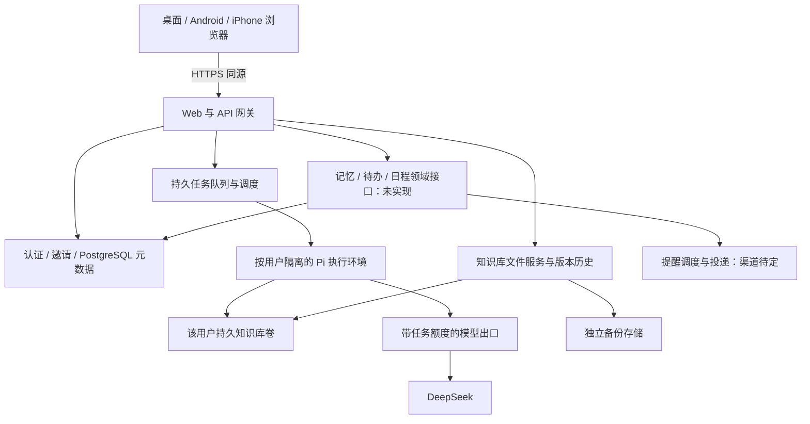

# Corilo 可里技术设计

v0.16 · 2026-10-21。用户已决定转为云端个人助手、邀请制小范围使用。以下区分目标架构与阶段实现；现已增加云端邀请/文件服务开发入口，未部署，真实身份联调与隔离 Agent 未完成。

## 1. 架构



正文保持普通 Markdown 与附件，工作树落在 Linux 持久磁盘；PostgreSQL 保存控制元数据及后续记忆关系、待办、日程和提醒的结构化记录，不把正文同时存进数据库制造双写。Pi 与文件服务操作同一用户目录。浏览器没有本地 Node、Git 或 Termux 依赖。

首期一台 Linux 主机承载网关、文件服务和执行调度，数据库可托管，备份离开该主机。此为小规模部署拓扑，不是高可用承诺；主机丢失时按备份恢复。无需首期引入 Kubernetes、Redis 或微服务集群。

## 2. 技术选择与实现边界

| 部分 | 选择与边界 |
|---|---|
| 页面 | 保留完整 Files.md 与现有适配层，响应式网页，同源 API；PWA 后补 |
| 服务 | Node.js 24 与现有 Pi SDK 锁版本，Linux 长运行服务 |
| 账号 | 已选用 Supabase Auth 适配器，真实项目尚未联调；应用自己核验邀请与成员状态，不信任客户端 userId |
| 元数据 | PostgreSQL；可与 Supabase 同用，用于身份映射、库归属、任务、事件和额度 |
| 正文 | 每用户持久 POSIX 目录；不将 Supabase Storage/R2 直接当 Pi 工作目录 |
| 版本与备份 | 每库 Git 历史；选用 restic + S3 兼容独立存储，R2 为优先候选，备份恢复未实现 |
| 执行 | 首个后端采用 Docker Engine，按 run 创建受限 Pi worker；内部 Docker worker 已接入，gVisor 后续验证 |
| 模型 | 首期 DeepSeek；沿用 Pi provider/settings，平台凭据保留在模型出口服务 |
| 域名与部署 | 已有域名，可继续 Cloudflare DNS；选用 Caddy + Compose，同源 HTTPS，部署待实现 |

代码已选择 Supabase Auth 的适配方式，当前环境未配置真实项目，本次未开通资源或产生服务费用。身份提供商可替换，已验证主体到内部账号的映射保持稳定。Pages 可后续分发静态页面；Workers、普通 Vercel 函数不承载默认 Pi shell 和持久工作树。首期同源服务避免不必要的跨域认证配置。

## 3. 控制面与数据布局

网关验证登录会话、账号有效性、资源归属和 CSRF/Origin；使用 HttpOnly、Secure、SameSite 会话 cookie，不沿用本机 URL fragment token 做云端账户。当前实现采用服务端验证邮箱/密码，没有 OAuth 回调。未来若增加 OAuth/授权码登录，其回调必须核验 state/PKCE；密钥不进入网页或知识库。浏览器不使用数据库 service-role key。

邀请兑换和建库需要数据库事务及唯一约束。当前 schema 包含 accounts、invitations、vaults、sessions，以及新增的 conversations、runs、run_events；model_grants/model_reservations 已保存调用准入预留；实际 usage/费用核对仍未实现。任务表与内部持久任务服务已加入迁移，但网关尚不开放任务 API，内部控制器已连接 Docker worker，模型出口已通过单任务 Unix socket 接入内部 worker。个人待办另用 todos 概念，与 runs 分开；记忆、日程、提醒的目标结构见第 13–15 节，尚无对应迁移。邀请只存不可直接复用的摘要、接收身份、期限及兑换记录。userId 从已验证会话解析；vaultId/conversationId/runId 查询均带所有者条件。

服务端布局示意（与当前 gateway 目录参数对齐；cloud-files 不启动 Pi，sessions 为后续预留）：

```text
持久卷 /tenant/<内部库ID>/
  knowledge/       Markdown、附件、内部 .git
  state/sessions/  Pi 原生会话
  pi/              该用户 Pi 原生设置；不含平台长期密钥
控制数据库          账号、邀请、任务状态、事件及额度
独立备份存储        带版本清单的正文/历史/必要状态快照
```

API 不向用户暴露宿主绝对路径。文件、搜索、下载和导出共用归属检查与路径边界检查。客户端目录名不能直接用作宿主租户路径。用户可影响的链接不跟随到卷外；下载内容不能变为同源可执行 HTML。

## 4. Pi 执行与隔离

Pi 默认工具、设置和会话继续使用，不重写 Agent 框架。每库最多一个执行租约，worker 只挂载该用户需要的知识库和状态目录；空闲回收 worker，不永久给所有注册用户开进程。文件服务可在没有活跃 worker 时读写知识库。

worker 使用非 root、受限 CPU/内存/PID/磁盘、最小能力和受控挂载，不开放 Docker socket，不提供控制数据库或对象存储管理凭据。禁止访问其他租户、宿主内部网络、实例元数据和管理端口。仅 cwd、不同 UID 或系统提示词不能代替完整隔离。容器共享内核仍有风险：邀请制测试先验证限制；公开运行不可信代码前评估 gVisor/微虚拟机等更强边界，不宣称普通容器绝对安全。

不能给可执行 bash 的 worker 注入平台 DeepSeek 长期密钥。使用 Pi 原生支持的 provider endpoint 设置连接内部模型出口，提供短期、限任务、限模型、限额度的调用身份；出口持有真实密钥、计量并撤销任务身份。worker 即使读取自己的调用身份，也不能越过该任务预算或读取其他用户资源。出口兼容性须对固定 Pi 版本做真实模型验证。这是平台凭据与用量边界，不新增用户模型配置表单。

首期不开放任意终端、扩展安装或插件市场；保留默认工具行为。网络请求走受限出口，必要模型调用和执行控制与一般互联网访问分开管理，防止内部网络探测。

## 5. Agent 执行任务与保存协调

PostgreSQL 兼任首期队列，不先引入 Redis。提交 prompt 以用户/会话作用域的 idempotency key 建唯一记录；持久化成功后返回任务 ID。调度器以事务取任务、获得每库租约并记录 worker 身份、心跳和过期时间。UI 可轮询持久事件，后续切 SSE；连接只是观察者，不掌控执行生命周期。

资源上限先配置后放行：每用户一个修改任务，全局并发与排队上限、最大执行时长、模型用量和存储额度。额度检查必须在服务端，实际消耗在模型出口记录；API 重试不能绕过计量。超时或停止需要终止任务的整个执行环境及其子进程，等待确认后才释放文件写入占用。

租约过期不等于进程已经死亡。失联后先隔离/终止旧 worker，避免新旧执行同时改同一库；确认结果前保持受限状态。持久任务标记 interrupted，不自动重放 shell。任务开始/结束、停止原因及必要进度写入控制状态，Pi 原生会话保存在独立目录。文件修改与任务状态不具备跨系统原子性，崩溃恢复需核对文件和历史，不能仅相信“完成”字段。

沿用现有文件 SHA/ETag 保护，在服务端扩大到全部设备和变更接口。新建、写入、移动、删除、恢复与 Agent 开始受每库协调控制；上传和请求体有大小限制。文件创建、移动、删除均增加库 revision，重连按 revision 刷新。其他设备的未保存草稿仍可能陈旧，保存时拒绝旧版本，不把通知机制当并发锁。

## 6. 历史、备份与迁移

Git 继续提供每库历史和 Agent 前后保存点，配置与秘密不入库。Git 默认工具可能修改挂载卷内容，历史不是防恶意篡改边界；独立备份由 worker 无权访问的服务完成。备份在协调的一致性窗口或存储快照上取得，记录文件/状态清单和摘要；恢复要实际重建并比对，分别定义正文、会话及任务记录的恢复目标。

迁移采用用户主动导入文件或安全归档，不删除原本地库，不自动带入 `.git`、Pi 配置或旧认证。先在暂存区校验路径、总量和名称，再发布并建立新的云端历史。用户导出普通 Markdown 与附件，云端无锁定格式。

现有 GitHub 双向同步实现保留回归测试，但云端首期不加载对应 UI、不自动调用旧 sync API。后续集成需独立设计服务端凭据与备份语义，不能直接复用开发机 credential helper 作为多用户认证。

## 7. 对现有代码的处理

| 现有实现 | 云端改造 |
|---|---|
| `app/vendor/filesmd/` | 保留原样、许可和固定来源；不重写编辑器 |
| `app/web/adapter.js` | 保留文件句柄适配，改为账户会话认证与云端错误处理 |
| `app/web/app.js` | 保留保存与对话，新增跨设备 revision、任务 ID、重连和草稿冲突语义 |
| `app/host/vault.mjs` | 复用普通文件/ETag/Git；补云端所有变更接口的版本与租约协调 |
| `app/host/agent.mjs` | 在隔离 worker 内复用 Pi SDK；配置与会话明确按用户分离 |
| `app/host/server.mjs` | 拆开认证/授权、文件服务与执行调度；不能简单改监听地址部署公网 |
| `app/host/sync.mjs`、`app/web/sync.js` | 暂保留旧模式和测试，退出云端首期入口 |
| `android/`、`app/host/android.mjs` | 暂停，保留历史；不再自动构建 APK 或要求 ARM64 bootstrap |
| `prototype/`、`p0/` | 历史资料，不扩展为云端入口 |

## 8. 实施顺序

| 阶段 | 可审查的完成条件 |
|---|---|
| 0 方向切换（已完成） | 正式设计、开发约束和 README 区分当前与目标；Android CI 仅手动保留 |
| 1 邀请与文件基础（部分实现） | 真实身份联调、独立建库、两账号访问隔离；跨设备保存/删除/移动冲突保护与重启恢复 |
| 2 服务端 Agent（内部执行基础已实现） | 受限 worker、持久 run 和幂等、停止/中断、模型出口额度；真实 DeepSeek 文件链路 |
| 3 个人记忆与行动（设计细化，未实现） | 来源与纠正、todos/events/reminders 分离；确定渠道后实现一次性提醒、修改取消和送达失败反馈，对应 N17/N18 |
| 4 资料自主与完整体验（部分基础） | 对话与事项引用的完整账号导出/导入恢复、历史恢复、独立备份；移动端对话与事项操作，对应 N13/N14/N16/N19 |
| 5 邀请版验收与上线（未完成） | 按 N01–N19 核对目标个人助手；明确待定产品策略、部署与运营参数，不能以文件开发版替代 |

阶段 1 可先联调文件服务；隔离/额度未完成前不向受邀用户开放 Agent。真实部署、开通云资源及付费另按用户授权执行。先做单机可用架构，数据卷与 worker 的位置关系明确后再讨论多机扩容；不能让任意机器读取仅存在另一台机器的本地目录。

## 9. 方向切换时的证据与限制

历史快照（方向切换提交 4bdf59b）：当时只完成方向、实施边界和 CI 触发调整，没有实现云端登录、租户隔离、数据库、远端任务或部署。现有本机宿主保持 loopback 约束，不开放公网端口。

此前 19 项 Node 检查与三套 Chromium 检查覆盖本地编辑、Pi 协议替身、Git 同步；它们不证明云端多用户能力。无真实 DeepSeek 和 iPhone/Android 浏览器验收。Android Actions 流程曾推送，但远端运行结果未确认；当前分支取消自动触发不会取消其他分支已排队或正在运行的任务。

旧版本完整设计、来源调查与检查记录保存在 [v0.12 提交](https://github.com/keanrain/corilo/tree/e25edb9/docs)。Files.md 来源以 `app/vendor/filesmd/SOURCE.json` 为准，Pi 以 `package-lock.json` 为准；商业发布前按实际依赖核对许可，不能用旧调查结论替代审查。

## 10. 个人助手方向与首批资料导出（2026-10-21）

最新定位为个人记忆与行动助手，简单使用和资料自主是产品约束。正文仍是普通文件；未来记忆关系、任务、提醒、时区及执行状态放入结构化存储，用引用关联资料，避免同一截止日期在 Markdown 与数据库双向维护。Pi 负责理解与推理，调度器负责确定时间的执行。一次性提醒先于外部日历、周期计划和主动回顾；公开接口与验收按业务规格第 6 节，不恢复旧原型业务。

历史快照（导出提交 5039344）：新增 `app/host/export.mjs` 和鉴权后的 `GET /api/export/knowledge`，在当前宿主管理的写入队列内创建 ZIP。采用锁定版本 fflate，保存普通文件原字节和相对路径、空目录、清单与格式说明，拒绝链接/特殊文件并限制总量，前后核对已读文件状态。页面“导出知识库”先保存草稿再触发浏览器下载。当时只接入本机接口；后续 9a22e27 已经通过云端网关复用。两种模式的 ZIP 都不是完整账号备份。

该提交先落地知识库导出；随后邀请登录和云端文件链路的实际进展见第 11 节。之后是隔离 Pi、可追溯记忆与任务、可靠的一次性提醒。不得把尚未落地的记忆/任务/日程写成当前已有功能。

本轮实测：21 项 Node 测试与三套 Chromium 脚本通过，新增真实页面下载 ZIP，并用 Python 标准库解压比对最新草稿。覆盖导出授权、附件字节、中文路径、空目录、校验清单、链接拒绝、资源上限与 Agent 互斥。无模型调用，不代表云端或移动端验收。

## 11. 邀请与云端文件首条链路（2026-10-21）

`app/cloud/accounts.mjs` 使用 PostgreSQL 事务、账号级 advisory lock 和邀请行锁兑换准入；每账号唯一库。邀请绑定已验证邮箱，仅存摘要，支持过期/撤销检查；登录 cookie 仅存随机会话凭证，数据库保留摘要和期限，查询时检查账号停用状态。Supabase password grant 只作为服务端身份验证，校验已确认邮箱与身份，不把 provider token 交给页面或写进知识库。当前使用已开通并验证的 Supabase 账号，无自助注册、OAuth 回调或邮件投递；不存在未实现回调却声称 PKCE 已通过的问题。

`gateway.mjs` 检查公共 origin、写请求来源和会话，并按数据库里的 vault UUID 选择文件宿主；不接受请求提供的用户目录。入口 loopback，生产需同机 HTTPS 代理。内部宿主使用 cloud-files 模式，禁止 Agent/Git 同步 API，不实例化 Pi 和 GitSync；页面隐藏 GitHub 入口、禁用 AI 发送，保留原话保存、编辑与 ZIP 导出。状态不返回磁盘绝对目录，新增文件也推进 revision，无草稿页面可刷新其他设备修改，旧版本写入仍被 ETag 拒绝。

真实 PostgreSQL 17.6、磁盘和 Chromium 已验证：并发邀请兑换仅建一库、错误/过期/撤销邀请拒绝、跨账号读取和路径穿越拒绝、两个会话旧版写入冲突、退出/停用生效、正常重启后的会话与文件恢复；390px 浏览器完成登录、原话保存、ZIP 下载和退出，另一个独立浏览器会话自动看到新增笔记。文件 revision 仅在实际刷新后确认，保存/导航期间延后的刷新不会被丢弃。身份提供商使用合成适配器，Supabase adapter 独立用响应替身测试，未连接真实 Supabase 或 DeepSeek。这是文件/API 归属隔离，不是 Agent 执行沙箱。原有本机测试与三套浏览器回归继续保留。

单实例最多 20 个驻留文件宿主，满额报错；无空闲回收或多机路由。迁移、受邀账号预开通及登录密码恢复需操作方管理；独立备份、公网安全审查与真实身份联调仍需完成；本轮文件版本和 Linux 文件宿主锁恢复补强见下。新服务尚未部署。配置与检查命令见 `app/cloud/README.md`，不能将第一条链路宣称为邀请版已可上线。

### 文件并发与宿主锁补强（2026-10-21）

删除/移动 API 现在强制 expected 来源版本，在同一宿主变更队列内验证后执行，目标已存在仍拒绝覆盖。文件使用内容 SHA-256；目录使用排序后的后代路径与 inode/size/mtime/ctime 等元数据摘要，包含隐藏后代但不跟随链接，覆盖受管理的写入、新增、删除和移动。列表与读取加入宿主队列，前端从已展示列表/正文保留版本；打开编辑器的版本独立于后续 stat 查询，不能为了删除而自动换成最新版本。目录有变化时保守拒绝并要求刷新，不承诺约束任意外部进程的同时修改；大库目录扫描性能尚待测量。

Linux 宿主通过短暂 `flock` 子进程对继承的文件描述符加内核锁，由父进程保留该描述符，无常驻锁辅助进程。锁文件 inode 保留，退出只清除 PID 标记并释放描述符。只对明确的 cloud-files 标记、确认 PID 不存在的情况自动回收；活跃/权限不明/损坏/旧版和本机 Pi 标记均拒绝。用途限同机本地文件系统与同一 PID 命名空间，不适用于 NFS、多容器独立 PID 空间或多机租约。非 Linux 本机模式保留原有独占标记行为。云端 Pi 仍关闭，不把文件宿主恢复推广为 Agent 子进程或 Git 写入中途的恢复保证。

验证增加真实 HTTP 旧版本删除/移动、目录后代变更、竞争移动、SIGKILL 后重启与并发启动单占用、未知标记拒绝；Chromium 验证过期页面删除/移动拒绝、刷新后目录操作成功；两个登录会话验证旧文件版本不能删除或移动新内容。Node 与浏览器回归、真实 PostgreSQL 云端检查结果记录在本轮提交；Supabase 仍为测试替身，无真实模型或移动真机验收。

### 持久任务基础（2026-10-21）

`app/cloud/runs.mjs` 新增内部 Runs 服务；`--migrate` 建立 conversations、runs、run_events，数据库复合外键校验账号/知识库/会话归属。创建会话及提交只接受控制面已验证的 owner；同一账号/会话/请求键返回原 run，不同正文复用键报冲突，数据库部分唯一索引保证每库最多一个 queued/running/stopping 任务。请求正文保存在私有任务表，不能复制到普通日志；其保留与账号删除策略仍需在开放前落实。

控制面必须显式提供最大执行数、排队数、租约秒数及任务时长，所有控制面实例须使用同一部署配置。短事务 advisory lock 串行容量检查、领取及状态变更；状态事件同事务提交。领取返回限任务随机身份，只存摘要；查询视图不暴露执行身份和 prompt。事件按游标读取，每次最多 100 条；这不是完整 Pi 消息/工具事件存储。

排队停止直接进入 stopped；执行中停止进入 stopping，并保留知识库及全局名额。过期租约不能续期，仍占名额，不自动重排。恢复先把异常任务设为 stopping，使旧执行不能继续续期；事务外由可信控制器停止并确认整个 worker 不再存在，成功后再写 interrupted 或 stopped 并释放名额。停止失败或无法确认则维持占用。账号停用阻止读写任务，排队任务中断，执行任务等待确认终止。整个服务尚未接收浏览器/worker 直接请求；`finish` 和恢复回调只能由可信控制器在确认退出后调用，不能用模型文字或 worker 自报成功替代。

真实 PostgreSQL 测试覆盖双提交、错用幂等键、跨用户读/停止拒绝、容量竞争、停止与完成竞争、过期续期拒绝、停止失败保留占用、服务/连接池重建后读取记录、超时与账号停用、不自动重放，以及数据库跨账号外键拒绝。停止确认回调为测试替身，没有执行真实 worker；不算 N10/N11 隔离执行验收。

此处为持久任务基础提交时的缺口；后续 Docker 进展见下。仍缺模型出口及 AI 用量预算、持久磁盘额度、完整消息事件和前端重连。现有网关继续返回 Agent 503；没有增加开发绕过开关，不能调用内部 `claim` 就宣称已可运行云端 Pi。下一条纵向链路须连接上述边界并实测实际进程停止。

### 内部 Docker 执行基础（2026-10-21）

`docker-workers.mjs`、`execution-controller.mjs` 和 `worker/main.mjs` 已加入。可信单机控制器通过 flock 单占用、持久启动日志及按 run 串行操作协调容器；创建结果未知时保留数据库名额与文件占用。确认整个容器删除后再保存 Git 历史并结束 run。文件宿主将占用持久化，重启不自动放行；终态已提交但占用未释放也可恢复，不重放 prompt。

worker 仅挂载当前知识库、会话状态、只读 Pi 配置和请求；Git 元数据/宿主锁嵌套只读。采用固定镜像、非 root、只读根、cap-drop、禁止提权、CPU/内存/PID/tmpfs 限制、无网络及禁止重启。复用 Pi 默认工具，没有新增工具审批框架。持久卷尚无硬磁盘额度；无网络测试不代表模型出口已验证。

真实 Docker/PostgreSQL 测试覆盖默认 Pi read/write/edit/bash、后台 shell 停止、只读挂载、无网络与 tmpfs 上限、停止/创建竞争、创建响应丢失后的延迟创建、文件宿主重启、终态后占用释放；正式 entrypoint 无模型凭据应失败。控制器重建测试不是进程 SIGKILL 或断电验证。独立控制器服务传输、模型出口、执行预算、持久磁盘额度、完整会话 UI 和公网部署仍未交付，Agent API 仍返回 503。详见 [运行说明](../app/cloud/worker/README.md)。

### 内部模型出口与调用额度（2026-10-21）

`ModelGrants` 与 Runs 共用短事务协调锁，核验领取身份、账号/知识库/会话归属、运行状态与时限；每 run 只签发一次模型身份，数据库保存摘要。请求次数、单次输出 token 和累计预留输出 token 在访问上游前原子扣减，失败或未知响应不返还，不通过重签身份重置额度。停止、终态、停用、撤销或过期后拒绝新调用；流式请求定期重查并取消上游连接，不承诺供应商立即停止计算或退款。

`startModelRelay` 为内部 loopback HTTP 服务，仅允许固定 completion 路径、配置的模型及 Pi/DeepSeek 协议字段；限制请求/响应字节、时长和并发，拒绝跳转，不自行重试。平台长期密钥只用于可信上游请求，客户端任务身份不转发给供应商，错误响应不透传供应商诊断。保留 Pi 原生配置和默认工具，没有增加模型管理 UI 或新依赖。

真实 PostgreSQL 检查覆盖竞争预留、独立请求次数、重复签发、伪造归属、重建连接池与停止/失效；真实 Pi SDK 使用原生配置，通过合成 SSE 上游完成分片工具参数、默认 write 写文件、工具结果回传和最终回答。此证据是本机协议联调，不是真实 DeepSeek 或容器出口验收。

此阶段提交时，Docker worker 保持无网络，出口尚未连接执行控制器/worker；后续连接证据见下一小节。预留输出 token 不是实际账单，输入/缓存/推理费用与用户每日预算仍需计量策略。单任务网络路径、身份装配/撤销、持久磁盘硬额度、实际模型和完整公网链路未完成。详见 [模型出口说明](../app/cloud/MODEL-OUTLET.md)。

### 容器内模型链路（2026-10-21）

`RunModelOutlet` 接入执行控制器，为每个任务签发唯一模型身份及私有 Unix socket，socket 在预留额度前核对精确 token 和任务归属。worker 保持 `network=none`，只读挂载该 socket；容器内桥只监听 loopback 并固定转发 completion 路径，不提供通用代理、CONNECT 或升级。只读挂载必要行为设置，不挂载源认证/模型目录；临时配置仍使用 Pi 原生格式，位于受限 tmpfs。容器与控制器当前使用相同非 root UID。镜像明确设置代码文件与目录的读取/遍历权限，避免受构建上下文 0600 权限影响。

任务结束、失败、停止和恢复先关闭出口/撤销身份，再确认容器终止；数据库撤销失败仍尝试停止 worker，文件占用不提前释放。socket 清理只操作已知文件与空目录，发现未知文件则保守拒绝，不自动重新签发任务身份。

实际 Docker/PostgreSQL 使用正式入口完成合成 SSE → 真实 Pi 默认 write/bash → 文件写入/结果回传。容器内检查仅有 loopback、没有源认证/模型文件或 Docker socket；另一个用户的有效 token 在当前任务 socket 被拒绝且不扣额度。流式停止取消上游、撤销授权、删除容器并释放文件占用。原启动/停止竞争、创建结果未知和宿主重启检查继续保留。测试没有调用真实 DeepSeek，不包含生产网络、控制器 SIGKILL、磁盘硬额度或完整费用验收。

这是内部链路。公共网关与网页仍未开放 Agent，CLI 不启动完整调度器；任务提交 UI、真实身份和模型联调、持久磁盘额度、部署与完整 N01–N19 仍待完成。会话查看和停止的后续实现见下；前面小节记载各阶段提交时的缺口。

### 会话查看与任务停止（2026-10-21）

公共网关新增正常应用会话鉴权的会话列表、详情和停止接口，不开放创建或提交。RunObservation 复用 Runs 的归属校验、短事务锁与停止状态迁移，不需要为只读网关虚设调度额度。前端提供日期列表、分页、任务状态与停止，切换设备重新读取，不自动提交或重放；刷新保留输入和编辑草稿。排队取消可直接终结，运行任务显示 stopping 直至控制器确认退出。

正文使用 Pi 原生当前分支投影，只展示用户/助手文本，不展示原始工具结果、思考块或错误诊断。读取在共享 Runs 协调锁内，仅当整个知识库没有活动任务时进行；通过 Linux 目录 FD 锚定、NOFOLLOW、普通文件/单链接检查和 4 MiB/2000 行上限限制磁盘读取。多个 session 文件暂不选择，返回 unavailable；压缩前原文、其他分支及图片不作为完整归档展示。

真实 PostgreSQL 和 Chromium 检查覆盖所属账号分页、跨账号读取/停止拒绝、同源保护、停止中状态、原生 Pi 当前分支、损坏/循环/超限/链接拒绝、跨设备查看、排队取消、文本转义及草稿保留。本机三套浏览器回归与 Node 测试继续保留。这些测试使用合成身份和会话，没有调用真实模型。

当前开发文件系统为 overlay，尚无经过验证的持久目录硬配额；扫描目录大小不能替代内核强制限额。任务提交、正式调度服务、真实身份/模型、完整费用和部署恢复仍未交付。

### 调度生命周期与存储诊断（2026-10-21）

`CloudHosts` 集中管理每库一个文件宿主，按数据库账号/任务归属取得宿主；同一库的并发初始化共享 Promise，失败释放容量，退出会等待正在初始化的宿主关闭。网关已复用该管理器；任务路径另核对 run 的 owner/vault/conversation，并准备会话目录。停用账号不允许浏览访问，但控制面仍能取得原任务宿主执行恢复。默认仍最多 20 个驻留宿主，没有自动回收。

`startScheduler` 是内部生命周期模块：取得控制器单实例锁，先恢复再按显式并发数执行批次，空闲时继续恢复，失败退避、不重放。关闭停止新领取，等待恢复中的外部操作，再关闭控制器并等待已领取任务退出。执行或停止失败不能吞掉；持久任务槽位、journal 和文件占用保留供恢复。日志回调只得到固定阶段错误码。批次会等待最慢任务，既有终态 journal 仍会重复扫描；吞吐、公平性与归档策略尚待优化，不是通用队列系统。

真实 PostgreSQL 检查覆盖宿主归属、容量、目录链接拒绝、停用后恢复、调度并发/退避、恢复/关闭竞争及停止失败。实际 Docker 测试通过调度器运行真实 Pi 默认工具，关闭时删除完整 worker、后台 shell 不再写入、释放文件占用，重启不重放终态任务。原正式 Pi/合成模型出口检查继续保留；均没有真实供应商调用。

生产 CLI 仍不启动调度器。文件宿主目前归网关进程所有，独立控制器不能重新打开同一知识库，也不能为共用对象而给公网网关 Docker 权限。还需实现窄范围、带鉴权的控制器到文件宿主通信后，才可接独立调度服务；当前测试内共享 registry 不代表该生产进程边界已交付。

新增 [存储诊断](../app/cloud/storage-quota.md) 用实际目录 FD 的 mount ID 检查文件系统，明确返回 enforcement=unverified。开发环境为 overlay，实际硬配额未实现。XFS 项目配额还须核验文件所有者不能改变项目 ID/继承属性，不能把非 root/cap-drop 当作充分保证；部署需验证 user namespace 或完整系统调用限制等边界。此轮没有格式化磁盘、配置宿主或运行特权容器。

## 12. 四项设计的共同边界

以下是 v0.16 实现方案，不是已可运行功能；第 11 节仍是当前代码证据。业务行为与待定策略统一见 [业务规格第 6–8 节](PRODUCT-SPEC.md#6-简单使用与资料自主)。沿用一个 Node 网关、PostgreSQL、每用户文件目录与隔离 Pi，不新增 MCP 框架、向量服务、Redis 或工作流平台。

| 数据 | 权威来源 | 派生视图 |
|---|---|---|
| 笔记、附件 | 用户持久文件目录 | 搜索结果、导出文件 |
| 记忆、待办、日程、提醒 | PostgreSQL 领域记录 | UI 卡片、JSONL、ICS |
| 对话 | Pi 原生会话与持久 run 记录，按消息 ID 关联 | 跨设备页面、标准化导出 |

不自动把 Markdown checklist 与数据库待办双向同步。文件写入、数据库事务和外部通知没有跨系统原子性，分别记录成功与失败。结构化对象使用账号作用域内稳定逻辑 UUID，导入不接受包内账号身份；文件来源使用相对路径及版本/内容摘要，不为每个文件强制建立身份注册表。

实施依赖保持第 8 节顺序：先补文件基础与隔离 Pi，再实现领域桥接及明确记忆/待办，确定通知渠道后接调度，随后完成账号资料包和恢复。完整导出需随新增实体一起维护，不能等上线后才发现记录无法迁移。

## 13. Pi 与结构化数据桥接

路径为 `Pi 默认 bash → 普通 corilo CLI → 现有网关内领域 API → PostgreSQL`。不替换 Pi 默认工具，也不把数据库管理凭据交给 worker。浏览器调用相同领域服务的校验逻辑。CLI 只负责传输与格式，固定受控 PATH，业务 JSON 通过 stdin/文件传入，禁止拼接不可信正文为 shell 命令。

以下仅为接口草案，当前不可运行：

```text
corilo todo list --json
corilo todo create --key todo-1 --json-stdin
corilo todo update <id> --version 3 --key todo-2 --json-stdin
corilo operation get --key todo-1 --json
```

仅提供限域的读取、创建、修改、完成/归档等操作，不提供原始 SQL、任意 URL 转发或选择 tenant 参数。调度器签发短期调用身份，服务端存摘要并绑定 owner、vault、run、scopes、期限与预算；停止、账号停用或 run 结束即撤销后续调用。worker 可通过 bash 读到自身身份，所以安全边界是 API 归属检查、预算和网络出口，不是隐藏 CLI。身份过期后仍可通过用户正常会话查询已提交结果。

领域写入以 `(owner, run, operation_key)` 唯一；浏览器使用 `(owner, client_operation_scope, operation_key)`，不虚构 run。保存规范化请求摘要，重复键同内容返回原回执，不同内容返回 409。变更、回执与供 UI 查询的领域事件在同一数据库事务提交；更新、完成和取消带预期版本，冲突返回 409，不静默覆盖。回执包含 operationId、对象类型/ID/version、状态及变更字段；错误返回 code/message/retryable 并使 CLI 非零退出。

UI 成功卡读取已提交的领域事件/对象，不相信模型文字或可伪造的 shell 输出。幂等只保证同一键，不保证模型换键后语义上永不重复；run 中断不得自动重放历史有副作用命令。创建待办及其提醒可作为一个领域事务，但不能声称同时写文件或发送邮件也原子完成。

通知 API 只引用用户在可信 UI 中验证并启用的 notification_target；worker 不可指定任意收件地址、修改绑定或直接发信。出口禁止借平台通知凭据绕过 API，也禁止控制数据库、宿主内网和元数据访问。首期 worker 默认出口只放行模型出口与领域 API，拒绝任意互联网外发；后续网页检索或下载需要单独设计受限出口，不能因默认 bash 可用就允许任意 curl 绕过通知边界。第三方收件人与外部日历邀请不在首版接口中。验证映射 N09–N12、N18：跨账号、过期身份、换内容重试、并发旧版本、停止后请求、限额及出口绕过均须实际检查。

## 14. 记忆存储与检索

目标逻辑模型如下，尚未创建数据库表：

| 实体 | 最小字段 |
|---|---|
| memories | owner、logical_id、text、status(candidate/active/superseded)、evidence_kind(user_statement/document/inference)、source_refs、version、时间、可选 replacement_id |
| memory_suppressions | owner、来源标识/指纹、来源版本、时间；不存已遗忘正文 |

消息来源使用稳定 message ID；文件来源使用相对路径、内容摘要/版本和可选片段位置。source_refs 不复制整份原文；展示时检查来源是否仍存在及版本是否一致。用户明确纠正更新逻辑对象版本；若保留可见旧文本，须纳入导出与删除范围。冲突候选可引用现有对象，不能静默把相互矛盾的信息都加入 active 集合。

首批先实现明确“记住/纠正/忘掉”的闭环，候选提取默认策略按业务规格第 8 节决定。检索只在所属账号的 active 记录中进行，先用有界文本查询与中文子串匹配，限制条数与注入长度；候选不作为事实自动注入，不先引入知识图谱或向量数据库。

遗忘事务删除目标记忆、其派生索引并记录不含正文的来源抑制；缓存同步失效。自动提取检查同源同版本抑制规则，导入不触发重新提取。抑制不能阻止 Pi 默认文件工具读取仍保留的原文，也不能识别所有复制改写。完整删除需处理来源、可见历史、会话及备份保留，不能仅删一行就宣称语义遗忘。验证对应 N17/N19，包括并发纠正、失效来源、冲突、遗忘后重提取及导出恢复。

## 15. 事项与提醒调度

目标实体尚未实现：

| 实体 | 最小字段与约束 |
|---|---|
| todos | owner、logical_id、title、open/done/cancelled、可选 due_date 或 due_at/timezone、version、source_refs |
| events | owner、logical_id、title；定时 start/end/IANA timezone 或全天日期区间；version、source_refs |
| notification_targets | owner、渠道、受保护的目标绑定、验证及用户启用时间、绑定版本/状态；worker 只见不透明 ID |
| reminders | owner、logical_id、可选 todo/event 引用、fire_at、IANA timezone、输入本地时间、target_id/绑定版本、version、调度状态 |
| reminder_deliveries | reminder/version、attempt、稳定 provider request key、lease、投递状态、provider reference、时间与脱敏错误 |

所有外键和查询校验 owner。具体时刻存 UTC 并保留 IANA 时区和输入本地时间；全天日期不转换成午夜提醒。时区修改、夏令时歧义和待办完成规则遵循业务规格。通知绑定不放进知识库或 worker；渠道选择建议邮件，但未选供应商、未配置凭据。

提醒调度状态为 draft/scheduled/paused/cancelled/expired；每次投递另用 claimed/submitting/accepted/delivered/failed/unknown。调度器用 `FOR UPDATE SKIP LOCKED` 领取到期记录，领取带租约；发送前事务重新检查账号、对象版本、关联事项和目标绑定，持久化 submitting 后才调用渠道，不跨网络持有数据库事务。

submitting 是取消保证的分界：此前的取消/完成使发送检查失败，此后可能已提交，UI 明确无法保证撤回。修改形成新版本，旧投递不覆盖新版本状态。claimed 租约超时可重新领取；submitting 超时或进程死亡转 unknown，不简单退回 scheduled。只有确定未发送，或供应商幂等保障仍有效时自动重试；结果未知时查询供应商并调和，不能为了重试成功而重复通知。

供应商回调须验证真实性、去重并关联正确版本，不允许乱序回调把较新结果降级。accepted 只表示供应商接受，delivered 仅在有渠道证据时显示，均不代表用户已读。服务恢复按配置宽限决定补发或 expired，宽限与重试上限是上线前运营参数；导入一律 paused，不进入自动补发。

ICS 是 events 的派生视图，使用稳定 UID、SEQUENCE/DTSTAMP，正确转义、折行、时区与全天结束日期的排他语义，默认不带 VALARM；JSONL 才是恢复依据。验收 N18 覆盖 DST、发送前后取消竞争、重复回调、未知结果、停机过期及重新打开待办，不能只测试数据库去重。

## 16. 完整资料包、恢复与自托管

保留现有 `corilo-knowledge-export` v1 的范围；另设计 `corilo-account-export` v1，以下均未实现：

```text
manifest.json
README.md
knowledge/                         原始正文与附件
records/                           JSONL：memories、todos、events、reminders、
                                   conversations、messages、references、versions、forget-rules
history/blobs/<sha256>              仍保留且用户可见的历史内容
conversations/<logical-id>.md       可读会话视图
calendar.ics                       可读日历视图
```

manifest 含 format/version、exportId、UTC 创建时间、snapshotRevision、可迁移偏好、文件路径/大小/SHA-256、实体计数与排除项。日期采用明确的 UTC/IANA/全天类型；对象保留逻辑 ID 与引用。认证 subject、内部账号/库 UUID、密码摘要、cookie、调用身份、模型密钥、渠道凭据、容器状态、租约和内部调试日志不导出。会话导出标准化用户可见消息及结果，不直接复制含运行头和待执行工具状态的 Pi session；历史不导出原始 `.git` 隐藏对象。

一致性导出取得每账号写入协调门，等待 Agent 结束或用户停止得到确认；暂停新的提醒领取，将在途投递核定为已知结果或 unknown。取得数据库一致快照并复制文件/会话后释放门，在副本上压缩，不全局冻结服务。仅限制一库受管理写入，不宣称默认文件工具变成跨系统事务。

首版只向空目标恢复，步骤为上传暂存 → 校验/预览 → 获得库协调门 → 持久化 import 状态 → 发布文件与数据库记录 → 完成并释放门。归档校验包括路径越界、链接/特殊文件、解压大小/数量/比例、重复及 Unicode/大小写碰撞路径、格式版本、ID 与引用完整性。摘要用于完整性校验，不代表内容可信。导入 owner 来自会话，不来自包。

以 `(owner, exportId)` 和包摘要实现重试：同包返回既有导入状态，同 ID 不同摘要拒绝。文件暂存目录和 DB 发布不是一个原子事务；单主机采用持久 import 状态及可重入发布步骤，在文件与记录均就绪前阻止读取半成品，重启继续或安全清理未发布状态。现有 host 固定路径尚无这套发布机制，必须实现并逐阶段崩溃测试，不能直接依赖 rename 宣称原子恢复。

导入对象保留逻辑引用；历史 run 不恢复执行租约，旧对话只读，新请求建立新 run。提醒全部暂停，旧通知绑定不复用，未来提醒需用户重新绑定并启用。保留投递历史作为历史，不让它进入调度队列。源文件引用按路径/摘要检查，不要求强制文件 UUID 注册。

同服务恢复合并包外较新的删除/抑制记录，不复活停用账号；独立实例导入旧包按业务规格展示快照范围，不可能获知未知的后续删除。用户下载副本无法撤销；服务器临时包应有访问控制、短期下载有效期和清理。运营数据库灾备与用户资料恢复分开设计，不能用全库 SQL dump 冒充个人可迁移格式。

自托管最低交付是版本化镜像及 Compose 或同等部署配置、独立认证、PostgreSQL/持久卷、HTTPS、隔离 worker、通知配置、管理员初始化、备份恢复、升级/回退说明、资源要求和许可清单。当前 CLI 固定 SupabaseIdentity，需要可测试的自托管认证适配器，或完整说明自托管 Supabase 的额外资源，才能做到不依赖 Corilo 官方控制面；开源代码不等于已交付自托管。建议先完整包及空库恢复，再自托管，再用户指定备份，未承诺日期。

验收映射 N14/N16/N19：带中文、附件、来源/历史与遗忘规则的往返样例；跨账号与恶意归档；导出时并发写入；导入各阶段崩溃；恢复后零工具执行、零通知；未知投递保留；禁用 Corilo 官方域名仍能独立使用自托管实例。

## 17. 成熟组件选型与接入边界（2026-10-21）

本节是针对邀请制、单台 Linux 主机的实现选型，尚未安装或部署这些组件。现有证据仍以第 11 节为准。目标是复用成熟基础设施，同时保留 Corilo 的用户授权、任务业务状态、资料协调及迁移语义；组件能力不能自动算作产品验收。

### 17.1 首期组合与保留范围

| 部分 | 首期决定 | 保留的 Corilo 职责与当前状态 |
|---|---|---|
| 编辑与 Agent | 继续使用 Files.md、Pi 默认 SDK/工具/配置 | 已接本机与云端文件模式；云端 Pi 尚未运行，不重写编辑器或 Agent 框架 |
| 身份 | Supabase Auth；接注册/恢复时采用官方 SDK 的服务端身份操作 | 保留邀请、内部账号、资料归属；当前仍是直接 password grant 适配器，未接 SDK 或完整注册流程 |
| 应用会话 | 首期保留不透明 HttpOnly Cookie 与服务端会话摘要 | 已实现退出/停用检查；不同时新增另一套浏览器 Supabase 登录态 |
| 任务 | 保留 PostgreSQL Runs 为唯一业务状态来源 | 已有幂等、容量和恢复状态；首期不叠加 pg-boss/Redis，不扩展成通用队列产品 |
| 沙箱 | 首个 worker 后端选择 Docker Engine；随后评估 gVisor runtime | 内部执行控制器与无网络容器检查已实现；出口已连接 worker，持久磁盘额度与完整隔离验收未完成 |
| HTTPS 与部署 | Caddy + Docker Compose；网页/API 同源 | 新增可复现部署与回退配置；不是将现有 loopback 入口直接公布到公网 |
| 构建发布 | GitHub Actions + OCI 镜像，GHCR 为优先仓库 | 已有测试 CI 与 worker 测试镜像构建；发布镜像及部署流程未实现，不自动修改仓库可见性 |
| 版本与备份 | Git + restic，备份目标采用 S3 兼容存储，优先评估 R2 | Git 基础已存在；一致快照、独立备份、恢复演练尚未实现 |
| 邮件 | Supabase 的邮件流程接正式 SMTP；Resend 为候选 | 尚未开通或选择套餐；认证邮件与用户提醒渠道分别决策 |
| 排障与监测 | 结构化脱敏日志、单个外部健康监测；需要时接 Sentry | 不先部署一整套指标集群，初期不启用会话录屏或正文采集 |

暂不引入 Kubernetes、Redis/BullMQ、Temporal、多套容器后端、独立向量数据库、通用插件平台、Coolify/Dokploy 管理面板。后续确有需求时单独评估，不预先写一套多供应商抽象层。模型初期仍只接 DeepSeek；模型出口只承担短期身份、受限转发、用量和撤销，不扩展成第二套模型管理系统。

### 17.2 认证收敛

Supabase 继续负责密码、邮箱验证与密码重置，Corilo 负责邀请准入、内部账号及资料授权。后续身份操作使用官方 SDK，避免继续手写更多认证协议；服务端客户端不持久化或跨请求共享用户登录状态，管理级凭据与普通登录客户端分开，只放可信控制面，不进入浏览器、worker、日志或知识库。

首期保留当前应用会话，是为了延续业务规格中的当前设备退出与账号停用语义，并适配全部数据经同源服务器访问的结构。Supabase JWT 的本地签名/过期校验不能单独证明其对应会话刚刚未被撤销；典型浏览器 SSR 会话的 Cookie/刷新设计也不等同于现有 HttpOnly 不透明会话。官方 SDK 可以复用，不意味着应直接套用另一种会话架构。

不将“Supabase 中有身份”当作 Corilo 准入。邀请兑换仍在 Corilo 数据库事务中完成；未来注册链接、邮箱确认和密码恢复必须校验可信回调及预期操作，防止开放重定向和重放。改密码/恢复密码后的应用会话撤销需显式衔接，不能假设身份提供商自动清掉 Corilo 的 sessions。建议密码重置成功后撤销该账号旧应用会话并要求重新登录，需同步到业务规格后实现。单独在 Supabase 管理台禁用身份不会自动撤销当前 Corilo 的 24 小时会话；停用以 Corilo 账号状态为权威入口，若允许外部管理台直接停用，必须补可靠状态同步或在线核验。

邀请开通建议由管理员发起并使用官方邀请/邮箱验证能力，关闭公共 signup；这是下一步注册流程建议，尚未发送邮件或在真实项目验证。先持久化应用邀请，再请求身份提供商发送开通邮件；两者不是分布式事务，发信失败或结果未知需保留可重试状态。链接 GET 不直接兑换应用邀请，避免邮件扫描器提前消耗；验证本人后再原子兑换建库。只隐藏注册按钮不能约束直接调用 Auth 接口，正式配置必须实测。

未来若改用官方会话作为唯一登录态，迁移前必须验证当前设备退出、多端会话、账号停用、并发刷新、过期草稿、CSRF/Origin 与邀请兑换；保持 provider subject 到内部账号/知识库的映射，不按邮箱猜测合并账号。一次性切换并撤销旧会话，不长期维护两套可互相绕过的登录凭证。

### 17.3 队列收敛

首期保留 `runs`/`run_events` 和简单 PostgreSQL 领取逻辑。当前主要缺口是执行控制器与文件写入协调，换成成熟队列不会替代这两项。全局短事务锁是小规模实现取舍，后续测量排队量及锁等待再判断是否调整；不因已有代码就宣称其适合任意规模。

pg-boss 可作为以后定时、通知或维护任务的候选投递层，但不直接用它的自动重试包裹 `Pi.prompt`。数据库任务投递保障不代表文件修改、外部 API 或整个 Agent 的副作用只发生一次。若引入，只投递 run ID/唤醒信号，由 Runs 再决定能否执行；不得同时让两套心跳/过期逻辑分别决定释放知识库占用。生产版本须固定并验证 retry、heartbeat、expiration、stop 行为，不能只改一个 retry 参数就认为没有重复执行。

采用条件是出现多个可安全重试的任务类型、需要成熟的定时/重试管理，或实测现有调度维护成本明显增加。新投递层需解决提交 run 与发送任务之间的原子性/补偿、重复投递和故障恢复；`runs` 继续是 UI 状态权威。未来提醒即使用队列，渠道接受后结果未知也不能直接重发。

### 17.4 Docker 与控制器的接入顺序

Docker 负责进程、挂载和资源限制；Corilo 控制器负责哪个 run 可以启动、属于谁、何时停止。首期只实现一个 Docker 后端，gVisor 的适配应优先复用同一 OCI 镜像并实测 Pi 默认 bash、Node、文件工具与网络代理。普通容器共享内核，不据此宣称可无条件公开运行不可信代码。Podman、Kata、Firecracker、托管沙箱后置，避免同时维护多套部署条件。

只有可信执行控制器可访问容器引擎。网页网关、Pi 容器、模型出口不需要 Docker socket；挂载只读 Docker socket 也不能作为限制 API 权限的办法。控制器接受持久 run ID，从数据库和受控目录推导挂载、镜像及资源，不接受浏览器/Agent 提供任意宿主路径或 Docker 参数。

worker 仅运行 Pi，不在容器内再启动现有文件宿主。`.corilo-host.lock/.flock` 仍归可信文件服务管理，不能跨不同 PID 命名空间复用其自动回收判定。为当前用户挂载知识库及独立会话状态；不挂载整个 tenant 根、运营者 Pi 认证目录、数据库/备份凭据。映射文件 UID/GID 需明确，不能靠全目录 chmod 777 解决写权限。

容器使用 `restart=no`，记录具体 container ID 与服务端标签；不自动清理不属于本控制器的资源。固定镜像 digest、非 root、只读根文件系统、最小 capability、禁止提权、默认 seccomp，以及 CPU/内存/PID/运行时间/临时空间限制进入创建参数；持久知识库另落实可验证的磁盘额度，bind mount 不会自动获得容量限制。用户 `.git` 若可被默认工具访问，仍不是防篡改备份；独立备份不交给 worker。

网络先按默认拒绝设计，按需放行模型出口和领域 API；普通 Docker bridge/`internal` 网络本身不等于完整租户隔离。不能让所有用户 worker 在同一可互访网络，不能放行宿主管理端口、数据库、元数据或任意互联网外发。具体网络规则与出口认证必须一起实测，包括 IPv4/IPv6、DNS、宿主网关和相邻容器；无网络的容器隔离测试也不等于已验证模型调用路径。

首期单个执行控制器运行；进程内互斥不能冒充跨实例锁。控制器要先实现启动/终止互斥，再连接网关：获得库写入协调 → 核验 run 仍可启动 → 创建并确认容器身份 → 运行；停止则禁止后续创建/启动 → 撤销调用身份 → 终止完整容器并确认退出 → 保存结果/历史 → 释放占用。一次 `inspect` 返回不存在不能排除迟到的 create 请求；确认失联控制器已停止或被阻止创建之前保留占用。确定的容器名仅用于定位，不代替控制权和生命周期互斥。

### 17.5 部署与备份收敛

首期 Caddy 提供同源 HTTPS，Compose 管理长运行服务，控制器按需创建短生命周期 worker。当前 gateway 仅监听 127.0.0.1；如果 Caddy 与网关分容器，后续必须给云端网关增加受控监听配置，只连接私有网络且不公开映射宿主端口。内部文件宿主继续 loopback，Host/Origin、Cookie 和来源检查不随容器化放宽。仅提交 Compose 文件不算部署完成。

Compose 重建网关/文件宿主容器也会更换 PID 命名空间，现有 `cloud-files:<pid>` 标记不能根据新容器里的同号 PID 判断旧进程。正式部署前需验证网关强杀和容器重建恢复，调整锁身份或采用已确认旧容器及全部挂载写入者退出后的受控恢复；不能在启动脚本中无条件删锁，也不能同时启动多个应用容器共享同一知识库。

Actions 在测试后构建 OCI 镜像、记录版本并推送选定仓库；部署使用固定 digest，保留上一可运行镜像。数据库迁移显式执行，镜像回退不代表数据库自动回退；破坏性迁移前需要兼容窗口及可恢复备份。GHCR 权限、私有镜像存储和 Actions 额度需按实际账号核对，不承诺免费无限，也不因使用 GHCR 就发布私有代码或资料。

restic 负责备份归档、加密、保留与还原，不负责跨 PostgreSQL/文件/正在运行 Pi 的一致性。首期在受控维护窗口停止新任务、等待/终止执行并阻止资料变更、协调提醒发送状态，再生成数据库逻辑备份和对应文件/会话副本，标记同一备份批次后恢复服务，最后上传副本。不能直接复制运行中的 PostgreSQL 数据目录或只备份当前 Markdown。数据库优先采用 pg_dump 等原生逻辑备份工具；备份频率、保留期和恢复目标须测量并在上线前确定。

托管 Supabase 的 Auth 身份与 Corilo 私有业务表是不同恢复边界：需要明确身份提供商备份/恢复方式与 subject 映射验证，不能把一份业务库 dump 宣称为完整账号灾备。备份密钥与生产磁盘分开保管，备份账户权限和删除权限按需要分离；加密备份不改变运行中服务能读取资料的事实。

恢复须到隔离目标核对清单/摘要和账号资料归属，撤销旧应用会话与执行身份，历史 run 不自动执行，待发提醒保持暂停；确认后再切流量。R2/S3 存储、密钥丢失、磁盘丢失、部分备份失败和版本不兼容都进入恢复演练。用户完整资料包与运营灾备仍分别验收。

认证邮件先由 Supabase 接正式 SMTP，是否选 Resend 与预算另定；不顺带决定用户提醒渠道。健康接口只返回必要状态，不带正文、账号和秘密；Sentry 默认不采集 prompt、正文、凭据或会话回放。Tailscale 可供管理员维护，Turnstile 可在出现滥用后评估，不作为当前每个用户操作的前置步骤。

### 17.6 下一步可验收交付

| 顺序 | 交付与检查 | 仍不能据此宣称完成 |
|---|---|---|
| 1 | Docker worker 与控制器：真实 Pi 默认文件工具、跨用户卷/网络拒绝、资源上限、启动/停止竞争及控制器崩溃 | 只有容器启动成功不算模型与用户完整链路 |
| 2 | 文件宿主协调、限任务模型出口、原生 Pi 配置及真实 DeepSeek；停止后无法继续调用 | 仅协议替身不算真实模型验证 |
| 3 | Supabase 官方身份操作、邀请开通/邮箱验证/密码重置；保留应用会话的撤销语义 | 仅登录替身不算真实邀请注册验收 |
| 4 | Caddy/Compose、镜像发布及隔离环境恢复演练；确认部署与运营参数 | 配置文件存在不代表已部署或可公开上线 |

以上为实现顺序，不是授权开通付费资源、发送邀请或部署。N01–N19 继续作为唯一产品验收编号；业务行为见 PRODUCT-SPEC，组件自带测试不替代跨组件验证。

### 17.7 来源与验证范围

选型检查日期为 2026-10-21（Asia/Taipei）；以下描述当时的来源核验，后续代码与真实 worker 证据见第 11 节。已核对仓库代码和以下可访问的官方源码/文档；没有安装候选依赖、执行真实 worker、发送邮件或进行部署/恢复演练。选型不构成当前套餐价格或免费额度承诺。

| 已读取来源 | 对应判断 |
|---|---|
| [Supabase Sessions](https://github.com/supabase/supabase/blob/master/apps/docs/content/guides/auth/sessions.mdx)、[服务端认证说明](https://github.com/supabase/supabase/blob/master/apps/docs/content/guides/auth/server-side/advanced-guide.mdx)、[密码认证](https://github.com/supabase/supabase/blob/master/apps/docs/content/guides/auth/passwords.mdx) | 会话撤销、Cookie/刷新与密码恢复需要按实际架构衔接 |
| [Supabase 管理 API](https://github.com/supabase/auth-js/blob/master/src/GoTrueAdminApi.ts)、[SSR 实现](https://github.com/supabase/ssr/blob/main/src/createServerClient.ts) | 可复用官方操作；不直接将客户端会话方案当当前应用会话替代 |
| [pg-boss README](https://github.com/timgit/pg-boss/blob/d4400859eed280b58c346f5289a0312913d558bd/README.md)、[QueueOptions](https://github.com/timgit/pg-boss/blob/d4400859eed280b58c346f5289a0312913d558bd/src/types.ts) | 固定调查提交的 retryLimit 默认 2，过期/缺失心跳可进入失败重试；未安装或选定该版本 |
| [Docker 安全](https://github.com/docker/docs/blob/main/content/manuals/engine/security/_index.md)、[bind mounts](https://github.com/docker/docs/blob/main/content/manuals/engine/storage/bind-mounts.md)、[资源限制](https://github.com/docker/docs/blob/main/content/manuals/engine/containers/resource_constraints.md)、[bridge 网络](https://github.com/docker/docs/blob/main/content/manuals/engine/network/drivers/bridge.md) | 容器、挂载、资源和网络策略须分别配置与验证 |
| [gVisor](https://github.com/google/gvisor/blob/master/README.md)、[Podman](https://github.com/containers/podman/blob/main/README.md)、[Kata](https://github.com/kata-containers/kata-containers/blob/main/README.md)、[Firecracker](https://github.com/firecracker-microvm/firecracker/blob/main/README.md)、[E2B](https://github.com/e2b-dev/E2B/blob/main/README.md) | 沙箱能力比较；未核验当前 VPS 兼容性、托管套餐或 Pi 实测性能 |

部分官方文档站点本轮访问被环境网络策略拒绝。以下是后续接入时的核验入口，未声称本轮已实时读取其内容：[Caddy HTTPS](https://caddyserver.com/docs/automatic-https)、[Compose secrets](https://docs.docker.com/compose/how-tos/use-secrets/)、[GHCR](https://docs.github.com/en/packages/working-with-a-github-packages-registry/working-with-the-container-registry)、[restic 数据库示例](https://restic.readthedocs.io/en/stable/080_examples.html)、[pg_dump](https://www.postgresql.org/docs/current/app-pgdump.html)、[R2/restic](https://developers.cloudflare.com/r2/examples/restic/)、[Resend/Supabase](https://resend.com/docs/send-with-supabase-smtp)。正式接入须固定版本、检查许可及实际账户条件，再做端到端验证。
