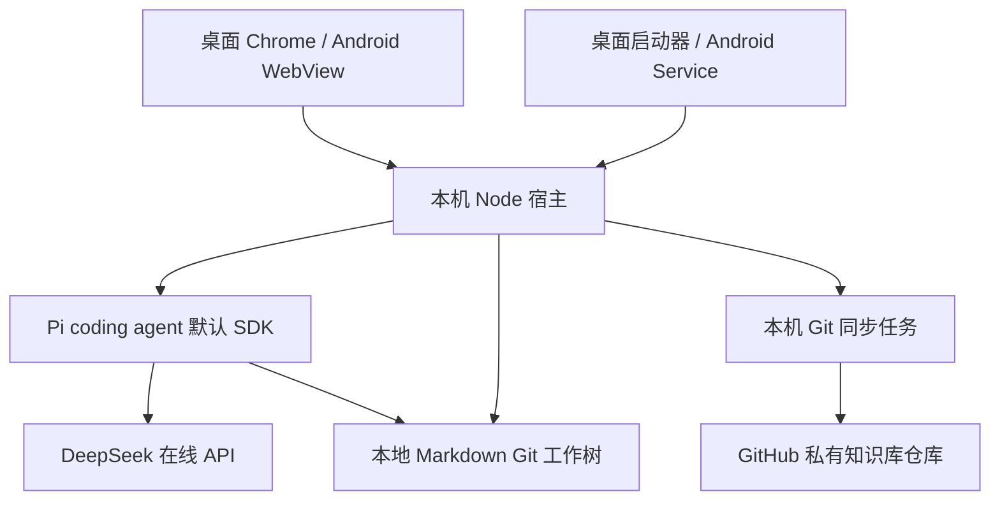

# Corilo 可里技术设计

v0.12 · 2026-10-09。当前文档定义目标实现，app/ 已开始正式实现；Python 原型独立保留。实现状态见第 10 节。

## 1. 总体架构

Files.md 提供完整 Web 页面和 Markdown 编辑器，替换原服务器与文件连接适配层，移除 Bot、Worker 和原同步调用。不要把现有 textarea 原型当作完成上游复用。保留上游许可和可追踪补丁，避免先重写编辑器。

Node 宿主提供本地文件 API、Pi 会话事件桥接和 Git 调度；桌面和 Android 共用核心逻辑。首期不引入云端业务服务器、Supabase、同步数据库或专有文件协议。

## 2. 模块与边界

| 模块 | 责任 |
|---|---|
| Web UI | Files.md 复用、对话显示、编辑反馈和同步详情 |
| 本机宿主 | 文件页面适配、运行生命周期、会话事件流、loopback 安全 |
| Pi | 默认 read/bash/edit/write 工具、provider/model 配置、会话和推理循环 |
| Git 任务 | 批次提交、fetch/merge/push、冲突保留和状态反馈 |
| 平台启动层 | 安装运行组件、启动/关闭进程、凭据存储、应用升级 |

Pi 采用 coding-agent SDK，具体接口按固定版本文档实现；不另造 Agent runtime。若使用 Pi RPC，stdin/stdout JSONL 仍需宿主转为浏览器事件，不能把 RPC 当作 HTTP 服务。前端只接本机宿主，不接收模型密钥。Pi 模型认证及模型选择直接复用 Pi 配置；后续 Git 凭据入口也不得在浏览器或日志中长期保留密钥。

文件页面使用普通文件读写接口；Agent 直接使用默认工具。可以协调编辑与同步时机，但不把 Pi 的每次写入改造成自定义审批/事务。默认 cwd 指向知识库，仅是工作目录，不是沙箱。对工具中断后的部分修改照实展示。

### Files.md 接入的必做改动

固定源码 `web/welcome.js` 使用 `navigator.storage.getDirectory()`，不可用时可回退内存文件系统；`web/lib/fs.js` 使用浏览器目录/文件句柄。这些入口不能原样沿用为正式存储。文件树、编辑保存、重命名、附件和搜索必须统一接到宿主的磁盘知识库，Pi 与 Git 使用同一绝对路径；禁用独立 OPFS/内存知识库回退。适配失败显示错误，不能悄悄切换到第二份数据。

复用完整编辑器并不等于不修改其调用链。先列出实际文件读写入口再逐一接入，使用“UI 保存→Pi 读取→Pi 修改→UI 刷新→重启读取”作为第一条集成验收。页面脚本、字体和编辑器依赖需要随应用提供，离线启动不能依赖 CDN。浏览器缓存仅作可丢弃缓存，不成为正文来源。

## 3. 数据布局与运行

知识库目录包含 Markdown、附件和 `.git`。Corilo 应用目录另存本机会话、运行日志及可重建缓存，Git 凭据未来单独使用平台凭据存储。模型配置与认证直接使用 Pi 的 `getAgentDir()`，默认 `~/.pi/agent/` 并遵循 `PI_CODING_AGENT_DIR`。Corilo 不提供配置表单、不复制 `auth.json`/`models.json`/`settings.json`，不强制覆盖已有模型或默认提供商；使用 Pi 现有认证和选择流程。配置目录与知识库分离，并在初始化 Git 或提交内容前检查，防止误把凭据纳入历史。

Pi 会话使用 Corilo 的 `config/sessions/`，恢复仍由 `SessionManager.continueRecent(cwd, sessionDir)` 处理；Pi 会按 cwd 过滤，不把不同知识库的会话混在一起。模型、工具及项目设置遵循 Pi 默认合并规则。

每个知识库仅一个本机宿主。启动器复用已运行实例，动态选择可用 loopback 端口并打开 Chrome。动态端口会改变网页 origin，因此设置和会话必须存于宿主，不依赖浏览器 localStorage 在重启后维持身份。浏览器重连时从 Pi 持久会话恢复已记录消息，再订阅实时事件；断线不重新提交 prompt。会话凭证限制在本机交接，校验 Host/Origin 和请求会话；不在日志或同步内容记录密钥。WebSocket/流式接口同样校验。原始异常保留在本地诊断，界面显示可操作摘要。

## 4. 桌面集成

Windows 11 x64 与 macOS 14+ Apple Silicon 优先，Chrome 为首期浏览器。需要安装 Corilo 启动器，但日常只操作网页。纯远程网页无法直接提供默认 Pi 所需 Node、shell 和 Git，因此本机组件随应用管理。

打包 Node、Git 以及 Pi 默认 shell 工具需要的 shell；Windows 需要兼容 Bash 的运行环境，不能假定 cmd 等价。macOS 也不以用户手动安装 Homebrew 作为使用前提。安装包分别锁定工具版本和校验值，发布前处理签名、macOS 公证及第三方声明。当前未选择和交付正式安装包，不把 Electron/Tauri 写成已经确定的依赖。

## 5. Android 集成

目标 Android 15/16/17、ARM64。APK 内置 WebView、管理 Node 的 Service 和 Termux 衍生运行环境，不依赖另一个 Termux APK。首次启动解压校验后的运行组件，初始化成功后启动宿主并打开页面。中途失败可重新初始化运行组件，不能删除知识库。

Termux 上游通过 bootstrap ZIP、JNI 和安装器恢复文件、权限及符号链接，随后执行原生程序。Node 和 Git 可使用 Termux 构建体系；但官方二进制绑定 `/data/data/com.termux/files/usr`。Corilo 独立包名意味着需要重建 bootstrap、Node、Git 及依赖，不能只改 APK 名称或复制官方包。更新也必须来自 Corilo 对应 prefix 的构建产物。

包中需有 Node、Git、Bash、证书；使用 Pi 的可选搜索工具时一并提供 ripgrep/fd，不能在 Android 下载普通 Linux 二进制。剪贴板优先使用 WebView/Android 接口，不要求额外 Termux:API 安装。

本次调查的 Termux app 使用 compileSdk 36、targetSdk 28。这不是 Corilo 对现代 Android 的兼容结论。计划使用 Android 17 对应 SDK 工具链；最终 targetSdk 必须在解决可执行文件限制、后台服务和上游构建适配后确定，不能通过简单提高数字宣称完成。首期个人侧载，暂不承诺 Play 上架。侧载并不会消除 Android 对应用可写目录执行文件的限制。保留上游 targetSdk 28 路线与提高 targetSdk 后的运行方式是两个不同方案，需在正式 Android 模块中尽早确定；在独立包名下执行 Node、Bash、Git 和 Pi 之前，不承诺该路线已可交付，也不静默退回另装 Termux。

Google 官方仓库在 2026-10-09 列出 `platforms;android-37.0` revision 2、channel-0，API-level 为 37.0。该事实证明 SDK 包可获取，不证明 Termux 派生 APK 在 Android 17 上可执行。必须真实完成自定义 prefix 构建与 Android 15/16/17 启动测试。

Android 私有目录作为真实 POSIX 工作树，SAF 用于导入/导出。系统可杀死后台进程；必要时按要求使用前台服务，但不保证永不停止。下次进入恢复宿主并标记未完成会话，不自动重放工具调用。

## 6. Git 同步实现

本地库即使未绑定 GitHub，也初始化独立 Git 仓库并完成初始提交；已有非空 Git 仓库不重建，先检查状态和历史。Agent 启动前保存编辑器内容并提交当前用户变更作为恢复基线，提交失败则不启动本轮修改。提交身份由应用本地配置，不依赖用户事先设置全局 Git identity。之后本机保存后批次提交。编辑器有未保存内容或 Agent 正在运行时不应用远端变更；收到 Pi `agent_settled` 且工具已停止后，提交已经发生的修改；不能以流式文本结束、网页关闭或断线判断整轮结束。系统提示词要求 Agent 不执行 Git 同步或后台脱离运行，宿主调度只协调其管理的写入，不声称控制任意 shell 子进程。同步调度每库串行，使用标准 Git，禁用 force-push。

顺序为检查状态、提交本地、fetch、合并、更新本机、push。远端在 push 前又发生变化时重新 fetch/合并，有限重试后保留待同步状态。不得将认证失败、读取失败或缺失扫描结果解释为用户删除。

先在隔离的 Git 合并目录或索引中完成合并。存在冲突则保持活动工作树干净可读，将双方版本提供给 UI；活动库发生新修改时重新计算合并，不能覆盖新内容。合并应用阶段与本机文件写入互斥。崩溃后以 Git 状态和实际文件重新检查，不能只相信内存“成功”。实现优先标准 Git 恢复路径，不再设计完整文件事务引擎。

文本、删除/修改、重命名和附件冲突都需测试。冲突处理生成普通提交。历史恢复复制旧版为新修改，不 reset 已同步历史。GitHub 绑定首期采用 HTTPS 和限制到目标仓库的 fine-grained PAT（Contents 读写）；通过 API 核对仓库身份、私有属性和目标分支。固定同步该分支，不跟随 Agent 任意切换；分支变化、未完成 merge 或 Git 锁异常先暂停并显示诊断。新建本地仓库可以推送到空远端；非空且无共同历史的两端不自动合并。GitHub 凭据由本机安全存储提供，通过受控凭据接口交给 Git，不写进 remote URL 或命令日志。

### 跨平台文件约定

Git 不保证任意文件名都能在 Windows、macOS、Android 互通。UI 创建时检查 Windows 保留名、非法字符、尾随空格/点及大小写冲突；同步应用前同样检查整个目标树。发现无法表示的路径时暂停应用并指出文件，保留本机内容和远端提交，不自动改名破坏链接。Pi 默认工具保持原样，因此 Agent 创建的文件也需经过同步前检查。文本使用 UTF-8；知识库 Git 配置不依赖机器全局 `autocrlf`，保留已有字节，不批量重写换行。首期不自动配置 LFS，超限附件失败可见。

### 修改结果和恢复边界

read/edit/write 的工具结果可以关联路径；bash 的任意输出不能作为完整文件变更清单。每轮前后结合 Git tracked/untracked 状态取得“本轮观察到的变更”，重新读取文件后生成卡片；存在外部编辑时不把所有差异归因于 Agent。忽略项不受 Git 历史保护，配置与缓存不显示为笔记结果。恢复通过选定历史版本生成新修改，不向用户承诺 Pi 默认工具自带撤销或多文件原子性。

## 7. 上游版本与已知证据

调查基线见 [upstream-baseline.json](upstream-baseline.json)。这份清单不意味着依赖已集成，正式引入后还需应用 lockfile 和平台构建校验。

| 项目 | 调查基线 |
|---|---|
| Files.md | `9e948ba6071e320c41c866f92817cf96f9bb7ba6`，MIT |
| Pi | `@earendil-works/pi-coding-agent@1.1.0`，Node >=22.19.0，MIT |
| Termux app | `8629e632fcb95da272221be327db653fb24befe9`，GPLv3-only |
| Termux packages | `9f94db4fcd0a9029079b27ffd253e5d80c4caaa8`；调查时 Node LTS recipe 24.18.0、Git 2.56.0 |

2026-10-08：Linux Node 24.19.0 上 Pi 默认工具 read/write/edit/bash 完成真实文件与 Git 调用，未调用模型。Android ARM64 npm 依赖解析和二进制载荷检查完成；没有运行 Android 设备测试。Termux bootstrap 已做下载与校验调查，但没有重建 Corilo prefix。证据摘录见 [本机检查记录](evidence/pi-host-smoke.json)。

分发 Termux 衍生 APK 须满足 GPLv3 相应义务，保留许可并提供相应源代码；不能因 Files.md 和 Pi 是 MIT 就把整个 APK 宣称为纯 MIT。正式分发前决定组合发行许可并纳入安装包。使用自己的发布签名，不复用上游测试签名。

## 8. 实施顺序与完成条件

| 阶段 | 直接交付正式应用的一部分 | 完成条件 |
|---|---|---|
| A 桌面纵向链路 | 引入完整 Files.md，Node 宿主、Pi/DeepSeek、启动器 | 点击启动、真实文件问答/修改、停止/失败回执；Windows/macOS 检查 |
| B GitHub 同步 | 设置、凭据、安全批次同步与冲突 UI | 两设备正常同步、离线重试、冲突保留、恢复旧版本 |
| C Android 运行环境与集成 | 与 A 同时开始自定义 prefix 和可执行路径开发；集成同一宿主和页面 | APK 冷启动、默认 Pi 工具、Git、升级恢复；15/16/17 真机矩阵 |
| D 个人可用发行 | 安装包、诊断、许可与升级 | C01–C21 按平台记录结果，未通过项明确列出 |

不再制作新的替代 demo。Android 运行组件重建是实际产品工程任务，应尽早开始，避免桌面完成后才发现集成阻塞。当前云环境的 Linux 检查不替代 Windows、macOS 或 Android 验收。真实模型检查需要安全配置 DeepSeek 凭据，不在文档写入秘密。

## 9. 来源

- [Files.md 固定源码](https://github.com/zakirullin/files.md/tree/9e948ba6071e320c41c866f92817cf96f9bb7ba6)
- [Pi 固定源码](https://github.com/earendil-works/pi/tree/ce950d78f424dcaf9f5d6a03ce80ab141130eb1d)
- [Termux app 固定源码](https://github.com/termux/termux-app/tree/8629e632fcb95da272221be327db653fb24befe9)
- [Termux packages 固定源码](https://github.com/termux/termux-packages/tree/9f94db4fcd0a9029079b27ffd253e5d80c4caaa8)
- [Google SDK 仓库元数据](https://dl.google.com/android/repository/repository2-3.xml)

旧设计、P0 历史和原型当时的完整说明通过 [设计索引](README.md) 中的历史提交访问；不再作为当前业务要求。

## 10. 首条实际链路（2026-10-09）

代码入口 `app/host/cli.mjs`，文件宿主 `server.mjs`，Pi 接入 `agent.mjs`，Git 与文件接口 `vault.mjs`。`app/web/adapter.js` 提供宿主文件句柄，`app.js` 接管初始化、保存和对话。Files.md Web 文件保持原字节，宿主返回 index 时注入适配层、移除临时存储脚本和旧 Service Worker 注册；返回 app.js 时移除绕过导航协调的旧 focus/blur 回调；运行时禁用旧同步和知识库诊断日志。CSP 阻止页面连接旧远端。

目前使用已安装的 Node/Git/Chrome，CLI 可尝试自动打开 Chrome，不代表原生安装器已完成。页面通过短间隔轮询显示 Pi 消息和运行状态，会话落盘仍由 Pi 管理。模型与认证直接读取现有 Pi 配置；Corilo 不调用配置写入接口、不维护自己的模型目录。

应用已检查真实磁盘、默认 Pi 工具、脚本化模型传输的完整 Pi 循环、会话重启恢复和 Chromium 编辑。测试替身仅替代模型响应或注入调度失败，不替代正式工具实现。真实模型凭据未配置，Windows/macOS/Android 未测试。

GitHub 同步、远端冲突流程和跨端检查仍待实现。当前单库锁只处理正常退出；强制终止后明确报占用，不自动覆盖锁或重复运行。草稿保存在当前页面，关闭页面可能丢失未保存文本，界面会触发离开提醒；跨进程草稿恢复尚未实现。

## 11. 代码复核与目标差距（2026-10-09）

本轮审查覆盖 Corilo 宿主、文件适配、页面生命周期、Pi 配置接入、测试和相关上游调用链；不是全部 vendored 依赖的安全审计。

| 发现 | 修复与证据 |
|---|---|
| 专用表单、独立模型配置目录和强制默认模型偏离需求 | 删除 UI 与 `/api/model`，读取 Pi 标准目录；真实 Pi 循环测试确认已有认证、模型和设置被使用且原文件不变 |
| 移动当前文件仍走上游覆盖写入路径 | 所有移动走宿主不覆盖目标的 rename，成功后更新编辑器路径；同名目标与源文件均保留；重命名/删除前后建立 Git 历史 |
| 分屏共享文件句柄上的版本导致旧草稿可能覆盖新内容 | 每个编辑器保留自己的读取版本；回归中打开另一分屏不能刷新旧草稿的写入权限 |
| 文件树将磁盘文件名拼接为 HTML | 返回 sidebar 脚本时改为文本节点；包含 HTML 的文件名只显示为文本，不能执行事件处理器 |
| 发送时可能只等待旧保存，漏掉随后输入；空闲轮询可能提前解锁 | 提交阶段独立锁定编辑器，等旧保存结束后再次保存最终草稿；回归模拟延迟写入、连续点击和期间轮询 |

前三个浏览器缺陷（移动、分屏、文件名）在旧代码上真实复现失败，修复后回归通过。当前共 10 项 Node 集成检查、8 项常规 Chromium 场景及 4 组专门回归；线上模型调用仍为零。

**达到的是 Linux 开发环境中编辑器、磁盘、Pi 默认工具和本地历史的初步集成目标，尚未达到个人应用完整交付目标。** GitHub 远程同步/冲突处理、桌面安装器及重复启动复用、Android 独立运行环境和 APK 均未完成；真实 DeepSeek、Windows/macOS 与 Android 平台验收尚未进行。完整会话切换、历史恢复界面、异常退出后的自动恢复也仍待实现。

## 12. Git 同步实现（2026-10-09）

`app/host/sync.mjs` 实现 Git 命令、GitHub 绑定校验和同步。生产只接受 GitHub HTTPS 仓库；通过 `git credential fill` 读取已有 helper 凭据，内存中用于 GitHub API 身份/私有属性/写权限校验，不写入 Corilo 配置、URL 或日志。命令错误不直接转发 stderr，避免 helper 泄露凭据。当前凭据管理器由开发机提供，尚未完成平台安全存储的打包与首启接入。

绑定元数据按库路径摘要隔离保存在知识库外。同步固定分支，检查未完成的 Git 操作；本地提交后 fetch，在库外临时 clone 中 merge，核对文件名、链接类型及本机 HEAD/工作目录未变化，再快进应用到知识库。push 不带 force，失败最多重新 fetch/合并一次；只有成功响应后保存最近成功提交及时间。临时合并目录随成功/重算清理，重启丢弃临时目录并重新合并。

冲突预览来自真实 Git index 的双方 blob。文本可手动编辑或选择版本，二进制/大于 256 KiB 的单侧内容只提供版本选择；两份模式产生不覆盖既有文件的随机后缀名。旧 HEAD 或工作目录变化会使处理请求失败，用户重新同步后再选。未解决的冲突不会进入活动知识库，解决完成后仍重新拉取远端，不能以过期结果强推。

宿主把同步、编辑和 Agent 启动互斥；同步时仍能读取状态，但暂停文件接口和编辑器。前台页面空闲 3 秒以上尝试同步，正常尝试间隔一分钟，前台恢复可提前触发，Agent 执行或冲突待处理时延后。此版网络等待期间也占用同步锁，慢网络下暂时只读最长可能跨越多个命令超时；本地草稿在同步前保存，失败恢复编辑。缩短网络阶段写入锁、原生后台调度仍未实现。

本轮 19 项 Node 测试、8 项常规浏览器场景、4 组浏览器回归及新增浏览器同步链路通过。验证使用 Linux 上的真实 Git、两个临时知识库和 bare 远端；覆盖双向独立修改、离线后重试、文本/删除修改/二进制冲突、过期选择、分支切换、无共同历史、Windows 文件名拒绝、并发 push 重试、绑定恢复和解绑。GitHub API 校验使用合成 credential helper 与响应替身；浏览器同步测试只替换远端身份校验，文件和 Git 全链路为真实执行。真实 GitHub 凭据、Windows/macOS/Android、真实 DeepSeek 均未验证。

本轮提供开发版同步能力，不代表阶段 B 全部完成：第二设备仍需 `git clone` 后以 `--vault` 打开；平台凭据初始化、图形化历史恢复、大附件具体失败诊断、安装器与 APK 待实现。C10–C14/C21 只有部分 Linux 证据，C01–C21 不据此整体标记通过。
