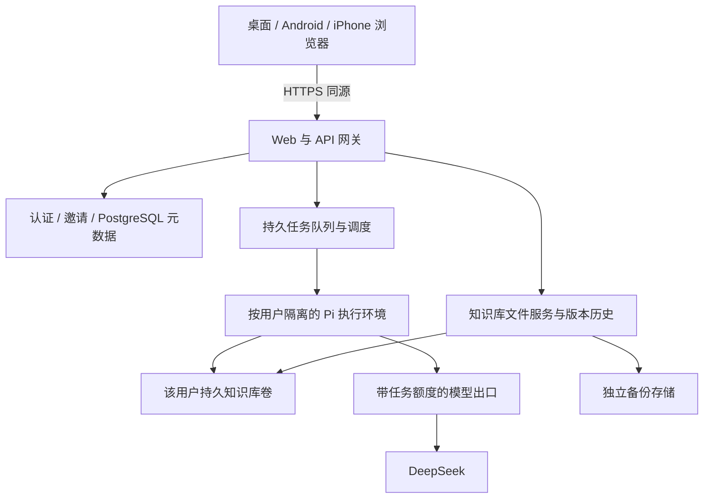

# Corilo 可里技术设计

v0.13 · 2026-10-21。用户已决定转为云端笔记、邀请制小范围使用。以下为目标架构；现有代码仍是本机宿主，未部署云端服务。

## 1. 架构



正文保持普通 Markdown 与附件，工作树落在 Linux 持久磁盘；PostgreSQL 保存控制元数据，不把正文同时存进数据库制造双写。Pi 与文件服务操作同一用户目录。浏览器没有本地 Node、Git 或 Termux 依赖。

首期一台 Linux 主机承载网关、文件服务和执行调度，数据库可托管，备份离开该主机。此为小规模部署拓扑，不是高可用承诺；主机丢失时按备份恢复。无需首期引入 Kubernetes、Redis 或微服务集群。

## 2. 建议技术选择

| 部分 | 选择与边界 |
|---|---|
| 页面 | 保留完整 Files.md 与现有适配层，响应式网页，同源 API；PWA 后补 |
| 服务 | Node.js 24 与现有 Pi SDK 锁版本，Linux 长运行服务 |
| 账号 | 建议 Supabase Auth 提供身份验证；应用自己核验邀请与成员状态，不信任客户端 userId |
| 元数据 | PostgreSQL；可与 Supabase 同用，用于身份映射、库归属、任务、事件和额度 |
| 正文 | 每用户持久 POSIX 目录；不将 Supabase Storage/R2 直接当 Pi 工作目录 |
| 版本与备份 | 每库 Git 历史，加独立对象存储备份；R2/S3 兼容存储可选 |
| 执行 | 按用户隔离的 Linux worker，默认 Pi 工具；限制资源和网络出口 |
| 模型 | 首期 DeepSeek；沿用 Pi provider/settings，平台凭据保留在模型出口服务 |
| 域名 | 已有域名，可继续 Cloudflare DNS；HTTPS 网关提供同源页面与 API |

Supabase 是实施建议，尚未开通项目或产生费用。身份提供商可替换，已验证主体到内部账号的映射保持稳定。Pages 可后续分发静态页面；Workers、普通 Vercel 函数不承载默认 Pi shell 和持久工作树。首期同源服务避免不必要的跨域认证配置。

## 3. 控制面与数据布局

网关验证登录会话、账号有效性、资源归属和 CSRF/Origin；使用 HttpOnly、Secure、SameSite 会话 cookie，不沿用本机 URL fragment token 做云端账户。认证回调核验 state/PKCE；密钥不进入网页或知识库。浏览器不使用数据库 service-role key。

邀请兑换和建库需要数据库事务及唯一约束。最小元数据包含 users/memberships、invitations、vaults、conversations、runs、run_events、usage。邀请只存不可直接复用的摘要、接收身份、期限及兑换记录。userId 从已验证会话解析；vaultId/conversationId/runId 查询均带所有者条件。

服务端布局示意：

```text
持久卷 /tenant/<内部库ID>/
  knowledge/       Markdown、附件、内部 .git
  state/sessions/  Pi 原生会话
  state/pi/        该用户 Pi 原生设置；不含平台长期密钥
控制数据库          账号、邀请、任务状态、事件及额度
独立备份存储        带版本清单的正文/历史/必要状态快照
```

API 不向用户暴露宿主绝对路径。文件、搜索、下载和导出共用归属检查与路径边界检查。客户端目录名不能直接用作宿主租户路径。用户可影响的链接不跟随到卷外；下载内容不能变为同源可执行 HTML。

## 4. Pi 执行与隔离

Pi 默认工具、设置和会话继续使用，不重写 Agent 框架。每库最多一个执行租约，worker 只挂载该用户需要的知识库和状态目录；空闲回收 worker，不永久给所有注册用户开进程。文件服务可在没有活跃 worker 时读写知识库。

worker 使用非 root、受限 CPU/内存/PID/磁盘、最小能力和受控挂载，不开放 Docker socket，不提供控制数据库或对象存储管理凭据。禁止访问其他租户、宿主内部网络、实例元数据和管理端口。仅 cwd、不同 UID 或系统提示词不能代替完整隔离。容器共享内核仍有风险：邀请制测试先验证限制；公开运行不可信代码前评估 gVisor/微虚拟机等更强边界，不宣称普通容器绝对安全。

不能给可执行 bash 的 worker 注入平台 DeepSeek 长期密钥。使用 Pi 原生支持的 provider endpoint 设置连接内部模型出口，提供短期、限任务、限模型、限额度的调用身份；出口持有真实密钥、计量并撤销任务身份。worker 即使读取自己的调用身份，也不能越过该任务预算或读取其他用户资源。出口兼容性须对固定 Pi 版本做真实模型验证。这是平台凭据与用量边界，不新增用户模型配置表单。

首期不开放任意终端、扩展安装或插件市场；保留默认工具行为。网络请求走受限出口，必要模型调用和执行控制与一般互联网访问分开管理，防止内部网络探测。

## 5. 任务与保存协调

PostgreSQL 兼任首期队列，不先引入 Redis。提交 prompt 以用户/会话作用域的 idempotency key 建唯一记录；持久化成功后返回任务 ID。调度器以事务取任务、获得每库租约并记录 worker 身份、心跳和过期时间。UI 可轮询持久事件，后续切 SSE；连接只是观察者，不掌控执行生命周期。

资源上限先配置后放行：每用户一个修改任务，全局并发与排队上限、最大执行时长、模型用量和存储额度。额度检查必须在服务端，实际消耗在模型出口记录；API 重试不能绕过计量。超时或停止需要终止任务的整个执行环境及其子进程，等待确认后才释放文件写入占用。

租约过期不等于进程已经死亡。失联后先隔离/终止旧 worker，避免新旧执行同时改同一库；确认结果前保持受限状态。持久任务标记 interrupted，不自动重放 shell。任务开始/结束、停止原因及必要进度写入控制状态，Pi 原生会话保存在独立目录。文件修改与任务状态不具备跨系统原子性，崩溃恢复需核对文件和历史，不能仅相信“完成”字段。

沿用现有文件 SHA/ETag 保护，在服务端扩大到全部设备和变更接口。新建、写入、移动、删除、恢复与 Agent 开始受每库协调控制；上传和请求体有大小限制。文件创建、移动、删除均增加库 revision，重连按 revision 刷新。其他设备的未保存草稿仍可能陈旧，保存时拒绝旧版本，不把通知机制当并发锁。

## 6. 历史、备份与迁移

Git 继续提供每库历史和 Agent 前后保存点，配置与秘密不入库。Git 默认工具可能修改挂载卷内容，历史不是防恶意篡改边界；独立备份由 worker 无权访问的服务完成。备份在协调的一致性窗口或存储快照上取得，记录文件/状态清单和摘要；恢复要实际重建并比对，分别定义正文、会话及任务记录的恢复目标。

迁移采用用户主动导入文件或安全归档，不删除原本地库，不自动带入 `.git`、Pi 配置或旧认证。先在暂存区校验路径、总量和名称，再发布并建立新的云端历史。用户导出普通 Markdown 与附件，云端无锁定格式。

现有 GitHub 双向同步实现保留回归测试，但云端首期不加载对应 UI、不自动调用旧 sync API。后续集成需独立设计服务端凭据与备份语义，不能直接复用开发机 credential helper 作为多用户认证。

## 7. 对现有代码的处理

| 现有实现 | 云端改造 |
|---|---|
| `app/vendor/filesmd/` | 保留原样、许可和固定来源；不重写编辑器 |
| `app/web/adapter.js` | 保留文件句柄适配，改为账户会话认证与云端错误处理 |
| `app/web/app.js` | 保留保存与对话，新增跨设备 revision、任务 ID、重连和草稿冲突语义 |
| `app/host/vault.mjs` | 复用普通文件/ETag/Git；补云端所有变更接口的版本与租约协调 |
| `app/host/agent.mjs` | 在隔离 worker 内复用 Pi SDK；配置与会话明确按用户分离 |
| `app/host/server.mjs` | 拆开认证/授权、文件服务与执行调度；不能简单改监听地址部署公网 |
| `app/host/sync.mjs`、`app/web/sync.js` | 暂保留旧模式和测试，退出云端首期入口 |
| `android/`、`app/host/android.mjs` | 暂停，保留历史；不再自动构建 APK 或要求 ARM64 bootstrap |
| `prototype/`、`p0/` | 历史资料，不扩展为云端入口 |

## 8. 实施顺序

| 阶段 | 可审查的完成条件 |
|---|---|
| 0 方向切换（本轮） | 五份正式设计、开发约束、入口 README 一致；Android CI 仅手动保留 |
| 1 邀请与文件纵向链路 | 登录、兑换邀请、独立建库、两账号访问隔离；两台浏览器编辑同一云端库且旧版本不能覆盖 |
| 2 服务端 Agent | 受限 worker、持久任务和幂等、停止/中断、模型出口额度；真实 DeepSeek 文件链路 |
| 3 云端使用闭环 | 会话切换与跨端恢复、导入/导出、历史恢复、独立备份恢复、移动端中文输入 |
| 4 小范围邀请上线 | N01–N16 按实际证据验收；部署、数据保留与用量配置清楚，故障可诊断 |

阶段 1 可先联调文件服务；隔离/额度未完成前不向受邀用户开放 Agent。真实部署、开通云资源及付费另按用户授权执行。先做单机可用架构，数据卷与 worker 的位置关系明确后再讨论多机扩容；不能让任意机器读取仅存在另一台机器的本地目录。

## 9. 当前证据与限制

2026-10-21 本轮只完成方向、实施边界和 CI 触发调整，没有实现云端登录、租户隔离、数据库、远端任务或部署。现有本机宿主保持 loopback 约束，不开放公网端口。

此前 19 项 Node 检查与三套 Chromium 检查覆盖本地编辑、Pi 协议替身、Git 同步；它们不证明云端多用户能力。无真实 DeepSeek 和 iPhone/Android 浏览器验收。Android Actions 流程曾推送，但远端运行结果未确认；当前分支取消自动触发不会取消其他分支已排队或正在运行的任务。

旧版本完整设计、来源调查与检查记录保存在 [v0.12 提交](https://github.com/keanrain/corilo/tree/e25edb9/docs)。Files.md 来源以 `app/vendor/filesmd/SOURCE.json` 为准，Pi 以 `package-lock.json` 为准；商业发布前按实际依赖核对许可，不能用旧调查结论替代审查。
